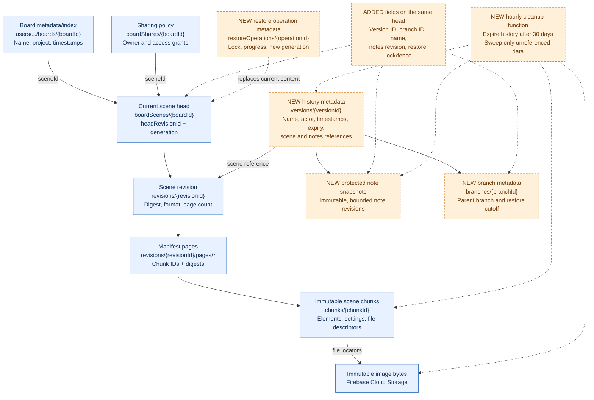
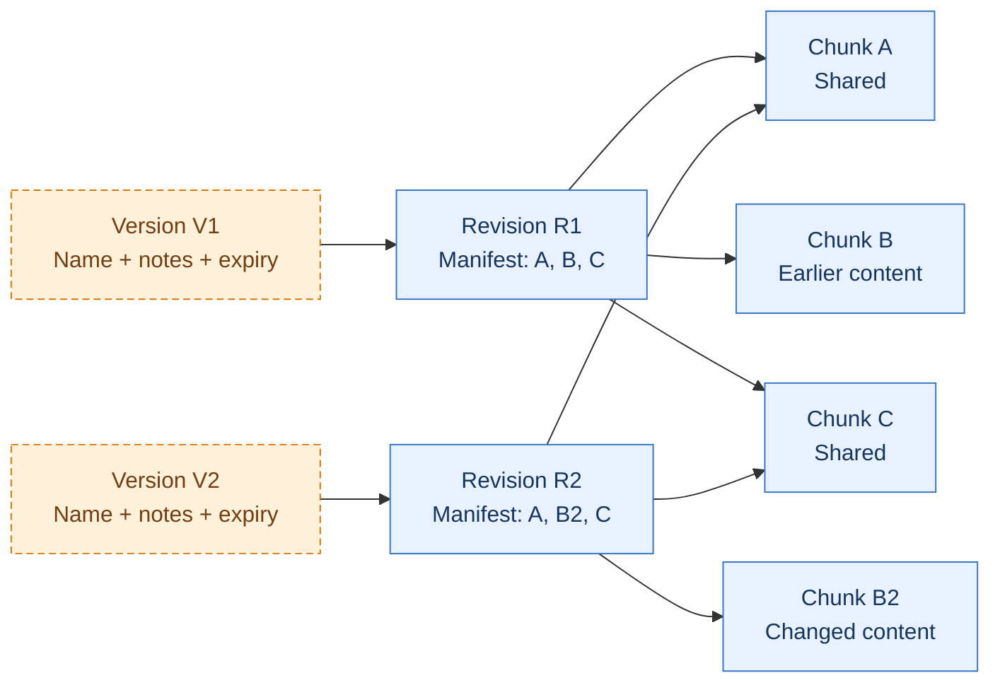
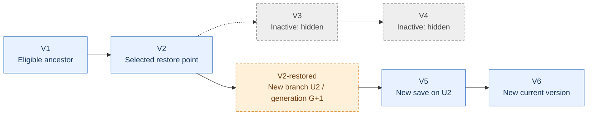
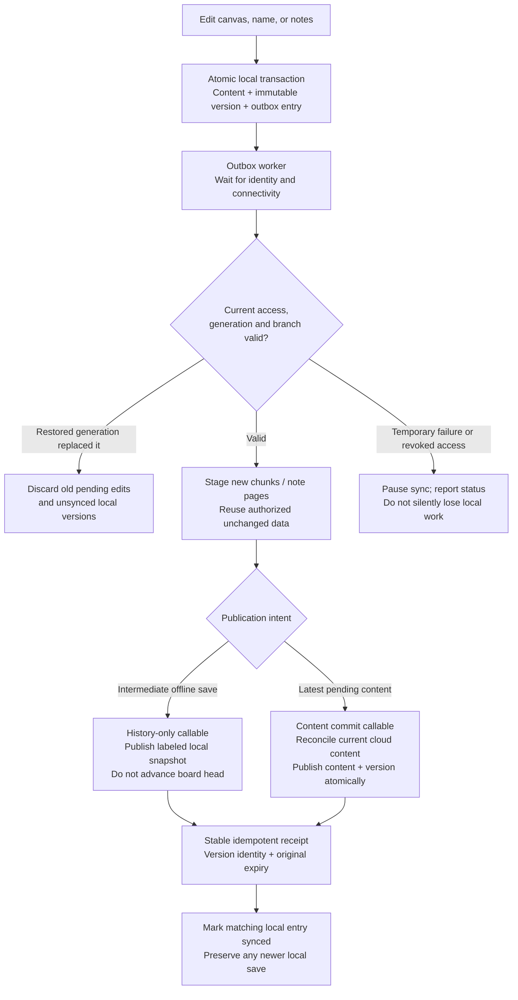
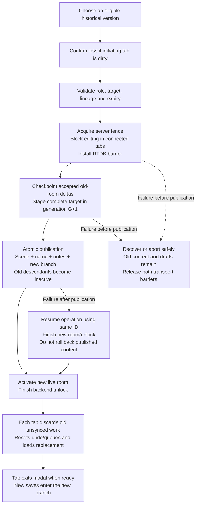
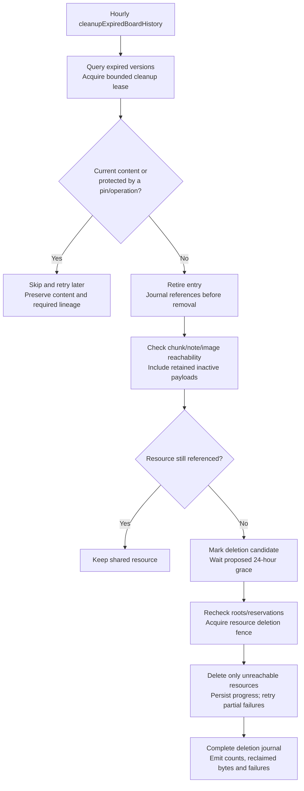

# ADR 007: Automatic board history and coordinated restore

- Status: Proposed implementation; product behavior agreed with the user. No runtime changes implemented.
- Date: 2026-10-11
- Related: [ADR 006](006-chunked-firestore-board-persistence.md), [ADR 003](003-image-access-and-soft-delete.md), [ADR 005](005-live-presentation-sharing.md)
- Replaces the recommendations in [the earlier feasibility research](../research/version-history-feasibility.md). That research predates the current canonical chunk implementation.

## Context

Users need to browse and restore previous board versions. The current app has immutable scene revisions but no complete user-facing board history or restore operation. A scene revision is insufficient: names and speaker notes save separately, and live collaboration uses an independent transport.

### Reader orientation

This is an Excalidraw-based React whiteboard app. Users organize boards into projects, draw/import content, create presentation slides from canvas frames, add speaker notes, and share boards or projects. A local WebSocket MCP bridge can also mutate the mounted editor. Users may work signed out, offline, alone, or with live collaborators. The effective board role is owner, editor, viewer, or presentation; direct board and inherited project grants combine, and public links can grant editor access to guest sessions.

There are three persistence mechanisms to coordinate:

1. **IndexedDB/RxDB:** device-local board state. Separate IndexedDB stores currently hold shared-board drafts and speaker-note drafts. A successful local save does not establish that another device can recover it.
2. **Firestore:** canonical cloud scene head and immutable chunk revisions, plus project/board metadata and sharing policy. A browser stages chunks; a trusted callable validates them and publishes the scene head. Names and notes currently have independent write paths.
3. **Firebase Realtime Database (RTDB):** live element changes and presence. These are latest-per-element records, not an append-only history. Cloud Storage holds immutable image bytes; scenes hold authorized locators rather than embedding those bytes.

Normal cloud saves reconcile concurrent elements using last-writer-wins (LWW) rules based on element version/nonce. This is appropriate for ordinary edits but cannot implement historical replacement: merging an old scene with newer elements could keep content the user intended to remove. Restore therefore needs a new generation and a backend fence across both cloud transports.

| Term           | Meaning in this decision                                                                                                                                                                                                                                                                                                                                                                                          |
| -------------- | ----------------------------------------------------------------------------------------------------------------------------------------------------------------------------------------------------------------------------------------------------------------------------------------------------------------------------------------------------------------------------------------------------------------- |
| Scene          | Canvas elements, persisted canvas settings, and file descriptors. Slides are frame elements with ordering metadata. Speaker notes and the board name are outside the scene today.                                                                                                                                                                                                                                 |
| Board          | A stable board identity plus project/ownership/sharing metadata and a pointer to current content. Cloud scene bytes live in immutable chunks; the editor assembles them into a complete local `BoardDocument`. Saving or restoring does not create a separate board ID.                                                                                                                                           |
| Board version  | An immutable, complete content snapshot: a scene revision whose manifest references an ordered set of immutable chunks, plus the board name and protected notes revision. Images are referenced through scene file descriptors. Lifecycle/branch eligibility determines whether that snapshot remains available for restore. It may describe a published cloud state or an explicitly labeled device-local state. |
| Local revision | A device-local optimistic save counter. It is neither a user-facing version ID nor a globally ordered sequence.                                                                                                                                                                                                                                                                                                   |
| Scene revision | An immutable chunk manifest. Merely existing does not prove that it became authoritative.                                                                                                                                                                                                                                                                                                                         |
| Content head   | The server-owned pointer to the currently published scene/name/notes tuple. Metadata indexes reflect this tuple, rather than independently deciding its name/content.                                                                                                                                                                                                                                             |
| Generation     | The replacement epoch of the board. Restore advances it so edits from before the replacement cannot merge into the new board.                                                                                                                                                                                                                                                                                     |
| Branch         | A timeline of saves beginning at creation or restore. The current branch, ancestor cutoffs, and explicitly admitted local-import side branches define active history; versions beyond a restored cutoff are inactive, hidden, and unavailable for restore. Branch identity describes lineage; generation fences writes.                                                                                           |
| Restore fence  | A monotonic operation token checked by writers/workers. It prevents a stale worker or queued mutation from bypassing a restore lock, including when a restore fails without changing generation.                                                                                                                                                                                                                  |
| Unsynced work  | Pending local canvas/name/note saves and historical entries not acknowledged by the server. Server-accepted RTDB deltas are checkpointed separately before restore; a browser's display or local “saved” status alone is not a cloud acknowledgement.                                                                                                                                                             |

The next section records the user's product choices. The remaining architecture is a proposed way to satisfy them, not implemented functionality. The concrete schema names, worker mechanism, numeric limits, and presentation grouping remain engineering details to finalize against tests and measurements. Do not reinterpret those details as additional user requirements.

### Agreed product behavior

- Record every successful content save; visually group entries without removing intermediate versions. No manually named versions.
- Restore canvas elements, images, slide structure/order, persisted board settings, speaker notes, and the previous board name. Keep current identity, project, ownership, sharing grants, and personal workspace preferences.
- Only owners and editors may browse or restore history. This includes editors using public links and authenticated guest sessions. Viewer and presentation roles cannot browse history.
- Preserve device-local history while signed out or offline and upload it after sign-in/reconnection.
- Keep cloud history for 30 days from first successful server publication/acceptance, including uploaded offline versions. Keep device-only history for 30 days from local save. Retried uploads do not reset expiry. Keep current content regardless of its age. The user delegated this retention-clock choice to implementation judgment.
- Before initiating restore, confirm loss of the initiating tab's unsynced changes, including local saves and note drafts.
- During restore, show a blocking progress modal in all connected editor tabs and prevent mutations. Restore in the background, then allow editing after the replacement is loaded.
- A successful **cloud-board** restore discards all pending old-generation edits and their unsynced historical versions. For a never-cloud-bound board, local storage is authoritative: local restore retains the target and its ancestor history, hides abandoned descendants, and discards pending edits. Previously cloud-published payloads remain physically retained until their original expiry/pins permit cleanup; only versions on the eligible active lineage remain browsable/restorable.
- Restore creates a new branch from the selected version. Versions after that point on the replaced lineage become inactive, are hidden, and cannot be restored. Their payloads remain subject to safe cleanup and original retention; inactivity is not permission to delete shared chunks immediately.
- Offline tabs receive the replacement when they reconnect. They cannot receive an immediate modal; stale writes must be rejected by the server.

### Actual implementation surfaces

| Source                                                                                                                                                                    | Current behavior                                                                                                                                                                        | Required change                                                                                                      |
| ------------------------------------------------------------------------------------------------------------------------------------------------------------------------- | --------------------------------------------------------------------------------------------------------------------------------------------------------------------------------------- | -------------------------------------------------------------------------------------------------------------------- |
| [Local storage](../../packages/storage/src/index.ts)                                                                                                                      | `BoardDocument` contains scene/name; `revision` is local, not a global version number. Saves overwrite the local document.                                                              | Immutable local version records, an upload queue, and atomic local restore/history capture.                          |
| [Workspace sync](../../apps/whiteboard/src/features/workspace/workspace-api.ts)                                                                                           | Uploads metadata before the scene and syncs the latest local board, not each intermediate save.                                                                                         | Queue every retained local save separately; distinguish history-only upload from head publication.                   |
| [Scene client](../../apps/whiteboard/src/features/scenes/scene-service.ts)                                                                                                | Stages immutable chunks, merges the source against current elements, and retries conflicts.                                                                                             | Historical revision loading, full-content commit identity, restore-lock handling, and viewer current-content access. |
| [Scene backend](../../functions/src/board-scenes.ts)                                                                                                                      | Stages revision manifests before atomically advancing the head. Chunk generation must match revision generation. Revision roots do not capture board names, notes, or full attribution. | Publish complete version metadata atomically with content; add coordinated restore and publication markers.          |
| [Editor](../../apps/whiteboard/src/routes/board-editor.tsx)                                                                                                               | Debounces canvas saves at 450 ms; has independent rename writes, save/draft queues, imports, MCP operations, and generation-conflict branches.                                          | History entry point and isolated preview; one shared editing gate; generation replacement/reset.                     |
| [Collaboration](../../apps/whiteboard/src/features/collaboration/collaboration-service.ts), [hook](../../apps/whiteboard/src/features/collaboration/use-collaboration.ts) | Elements and presence use board-scoped RTDB paths, without generation in the client interface.                                                                                          | Generation-scoped rooms and backend write fences; reconnect checks before replay.                                    |
| [Abandoned-room compaction](../../functions/src/index.ts)                                                                                                                 | Checkpoints latest RTDB element records after the last presence leaves; checks generation but still uses legacy paths.                                                                  | Generation-scoped triggers/cleanup and restore-lock checks, including final publication.                             |
| [Notes backend](../../functions/src/slide-notes.ts), [local notes](../../apps/whiteboard/src/features/slides/notes-store.ts)                                              | Mutable note documents, independent revisions/drafts and retries; no board generation in note mutation identity.                                                                        | Immutable note snapshots/manifests, generation and lock checks, and atomic version publication.                      |
| [Sharing](../../apps/whiteboard/src/features/sharing/sharing-service.ts), [policy backend](../../functions/src/project-access.ts)                                         | Name appears in owner metadata and `boardShares`; shares can retain legacy embedded scenes.                                                                                             | Restore name consistently without changing policy; fence legacy/name write paths.                                    |
| [Assets](../../apps/whiteboard/src/features/assets/scene-assets.ts), [gateway](../../functions/src/board-assets.ts)                                                       | Immutable image objects referenced by descriptors; byte reads use current board policy.                                                                                                 | Retention pins and historical access checks for assets not in current content.                                       |
| [Rules](../../firestore.rules), [RTDB rules](../../database.rules.json), [Storage rules](../../storage.rules)                                                             | Scene history/chunks use board read access; notes use a separate callable; legacy snapshot paths exist.                                                                                 | Restrict history payload access, protect notes, and enforce restore fences across transports.                        |

### Storage structure: existing versus proposed

Blue boxes describe existing structures. Orange dashed boxes describe new versioning structures or added fields. Arrows describe references or control responsibilities, not a claim that all fields already exist. Existing scene revisions/chunks are reused; history is not a collection of separate boards.



Owner metadata and sharing policy remain separate from content. Scene revision roots/pages describe the chunk snapshot; version metadata binds that scene to its name, protected notes, lineage, actor, and expiry. Notes text is not copied into public scene chunks. Current notes presently live at `slideNotes/{boardId}/notes/{slideId}`; the protected immutable historical-note layout is still to be finalized. Image objects retain the existing private/shared asset roots authorized by the asset gateway. Local versions/outbox live in IndexedDB, not in additional cloud board documents.

## Decision

### 1. Version complete board content

Keep `boardScenes/{boardId}` as the canonical scene location. Extend its small server-owned content head with a name and a protected notes-manifest identity. Every successful content mutation publishes a `versions/{versionId}` record in the same transaction that changes this head.

Suggested model, subject to implementation naming:

```text
boardScenes/{boardId}
  headRevisionId, generation, contentSequence, currentVersionId, currentBranchId, historyEpoch,
  boardName, nameRevision, notesRevisionId, restoreOperationId, restoreFence

boardScenes/{boardId}/versions/{versionId}
  sceneRevisionId, sceneGeneration, notesRevisionId, boardName, localParentProvenance?,
  branchId, contentSequence?, branchSequence, parentVersionId?, contentDigest, reason,
  actorUid, actorDisplayName?, mutationId, serverCreatedAt, expiresAt,
  origin: cloud | offline-import, capturedAt?, sourceBaseVersionId?, restoreOf?, replacedHeadVersionId?

boardScenes/{boardId}/branches/{branchId}
  parentBranchId?, forkVersionId?, forkSequence?, rootVersionId,
  generation, createdAt, kind: canonical | local-import, admittedHistoryEpoch?

boardScenes/{boardId}/restoreOperations/{operationId}
  actorUid, targetVersionId, sourceGeneration, targetGeneration,
  fence, state, leaseUntil, targetPinId, operationDeadline, resultingVersionId?, errorCode?

protected note revisions/manifests
  immutable bounded pages, accessed through authorized server operations

local IndexedDB history
  identity, boardId, localVersionId, generation, branchId, name,
  localSceneRevisionId, localNotesRevisionId, capturedAt, parentLocalVersionId?, branchSequence,
  contentDigest, uploadStatus, mutationId

local IndexedDB immutable payloads
  scene manifests/chunks and protected note snapshots referenced by local history

local IndexedDB outbox
  identity, boardId, localVersionId, mutationId, sourceBaseVersionId,
  generation, expectedFence, branchId, publicationIntent, changedFields, fieldBases,
  captureMutationId, headMutationId?, retryState, receipt
```

Do not put speaker-note text inside broadly readable scene chunks or version metadata. Reuse unchanged scene chunks within a generation and unchanged protected note pages. Names/notes can create a version while referencing the unchanged scene revision. Bound manifests and note pages rather than putting all notes in a single document.

`contentSequence` orders cloud head changes; local revisions and reported capture times do not. An offline-import entry is historical evidence of a local save, not a claim that the shared board once had that exact global state. Label it accordingly and keep its source/base identity. Uploading such an entry must not move the current head or replay its intermediate scene into collaborators' boards.

Record cloud entries only for successful publication, never by listing all revision documents. The current backend can leave valid staged revision roots behind after a losing head race. Add an explicit publication receipt/marker and link history in the final transaction. Same mutation retries return the same receipt/version identities. An unchanged canonical tuple is a head-publication no-op; a distinct successful local snapshot still requires historical acceptance as specified in the receipt contract below. A later intentional return to earlier content still creates a new version.

All mutations must carry the content base, generation, and idempotency identity, including metadata-only and note-only operations. The server reads the latest head inside the publication transaction and preserves unrelated current content. Do not copy a name/notes snapshot read before a concurrent commit over newer data. Stage bytes before publication; validate policy and the restore fence again inside publication.

Capture actor as the submitter, not necessarily the sole author: collaborative scenes can contain work by several people. System compaction is attributed as a system checkpoint, not an edit by the owner whose UID it uses for authorization.

#### Chunk snapshots and active branches

A version references complete content rather than an element-diff chain. For example, scene R1 references chunks `[A, B, C]`; after editing B, R2 references `[A, B2, C]`. Both revisions share A and C, and each can be assembled independently. Board versions also reference the name and protected notes corresponding to that save. A chunk is an immutable payload block, not itself a version or an active/inactive board.



Only B2 plus revision/history metadata is added for this save. The unchanged chunks are reused. This is a complete snapshot by reference, not a diff that must be replayed against V1. Name-only or note-only versions can reference the unchanged scene revision.

Restore changes the timeline as well as current content:



The blue lineage remains available subject to expiry; the orange restore starts the new universe. Gray abandoned descendants are unavailable for preview/restore even while their physical payloads remain retained for cleanup.

The new restore version has `parentVersionId = V2`, `restoreOf = V2`, and `replacedHeadVersionId = V4`. It does not treat V4 as its content parent. Old V3/V4 payloads are not rewritten and cannot be selected for another restore. Ancestors V1/V2 remain eligible only while within their retention window. The restore version itself gets its own normal 30-day cloud retention window.

Use `currentBranchId` and server-owned branch fork/cutoff metadata to derive `active` membership. A canonical version belongs to the current branch or a permitted prefix of an ancestor branch. Historical-only local-import branches are additionally admitted into the current `historyEpoch`, subject to their source-base eligibility. The imported-lineage contract below defines their ordering and what survives a restore. Restoring an ancestor narrows the inherited prefix and excludes all abandoned descendants, including prior restore branches after that point. Do not implement this as `createdAt > target.createdAt`: device timestamps, offline imports, and later saves on the new branch make that incorrect. An imported local version carries its source/base and explicit local-parent lineage; upload time never determines ancestry. Restore advances `historyEpoch`, closes previous side-branch admissions, and inherits only the selected target’s ancestor path.

Publish the new branch/head and its cutoff atomically with the restored content. Avoid synchronously updating an unbounded number of version records to `active: false`; a derived lifecycle status gives the same behavior immediately. Any materialized per-version status is a server-owned cache and cannot override canonical branch eligibility. Branch metadata must remain available while descendants need it, even after individual ancestor version payloads expire. Bound/compact ancestry metadata without reviving excluded versions.

History listing, preview/read, and restore must enforce active lineage on the server, not just filter the sidebar. Cancel old preview loads when a replacement changes their eligibility. Already delivered bytes cannot be revoked. Inactive versions retain their original expiry for physical cleanup, but are unavailable immediately after restore. Reader pins may protect physical bytes temporarily; they do not authorize new reads of an inactive version.

For chunks after restore, retain anything reachable from current content, unexpired retained version payloads, or active operation/reader/staging pins. The restored scene is repacked into the new generation as described below. Abandoned versions' exclusive chunks eventually become reclaimable when their retention/pins end; shared chunks remain until their last protected reference is gone. Immutable images and protected note pages follow the same rule.

### 2. Capture every local save without duplicating acknowledgements

Capture changed content when a logical local save succeeds (the boundaries below), not on every `onChange`, cursor movement, selection, font normalization, or viewport change. Maintain per-save identities, not just the latest board snapshot. Persist the board mutation and its immutable history/queue record together; refactor the current separate local stores as needed to make notes/name/scene snapshots consistent.

Cloud acknowledgements mark the corresponding local record as published rather than recording another identical version. Conflict reconciliation may produce a different cloud result: retain the local entry with its local origin and associate it with the canonical published result. History-upload retries deduplicate by identity and verify the digest; distinct saves are not deduplicated solely by equal content. Unknown or stale generations never get silently adopted into the current generation.

#### Local outbox and Firebase publication

Use both local capture and server publication, with distinct responsibilities. Each successful changed local save atomically records current content, an immutable local version, and an outbox entry. An outbox worker sends data after sign-in/reconnection; Firebase validates it and publishes the canonical cloud history. Extend the existing local storage/sync rather than assuming Firestore's cached writes already preserve every intermediate local version.



For example, offline saves L1 -> L2 -> L3 remain individually recorded locally. L1/L2 upload as historical local snapshots; the latest pending L3 synchronizes with current cloud content and may produce a reconciled canonical result. Do not make collaborators' boards cycle through L1/L2 merely to populate history. Notes/name operations require the same safe base/generation rules. Capture logical local-parent/source-base references so history remains understandable even when upload order or cloud reconciliation differs.

Version creation for canonical cloud saves belongs inside the successful backend content commit, in the same publication transaction. Do not use a separate Firestore document-change trigger to create those versions afterward: that would allow a published board without its corresponding history and require recovery for duplicate/out-of-order events. System compaction also publishes through this content commit contract. The scheduled cleanup function is independent of version creation.

Outbox records carry identity, board/version/mutation IDs, source base, generation/branch, **expected restore fence**, per-field mutation intent/bases, content digest, intent, retry state, and receipt status. Retry the same mutation identity after an ambiguous response before restaging; never reset expiry on retry. Keep cloud receipt/version identities separate from the local optimistic save counter. A local restore/claim must explicitly map local branch identities into authorized cloud lineage rather than treating a device generation as a cloud generation by coincidence.

Prefer immutable local chunk/note references in history, with the assembled current `BoardDocument` retained for the editor. Storing full assembled board payloads in every local historical record would forfeit the cloud chunk-reuse benefits and substantially increase device storage. The exact atomic local chunk/outbox layout remains an implementation decision.

An offline local board can browse/restore its own history with a device-local generation and same-origin tab coordination. Its committed local target/ancestors survive; abandoned descendants are hidden and retained until their original local expiry. Pending edits are discarded after local publication. If claimed later, upload only eligible retained history and the current branch, mapping local ancestry into server-owned identities; do not upload the hidden abandoned universe. A board already bound to cloud requires connectivity for restore, even if its preview is cached: an offline client cannot acquire the shared editing lock. A local-only target for a cloud board must be uploaded and validated before a cloud restore can start. Show a clear network requirement instead of queuing a destructive restore for later execution.

Protocol-0 rollout recovery must bind legacy capture ancestry before hydration projects a protocol-1 `cloudVersionId` into current local metadata. Already-affected devices need an idempotent atomic repair of missing source bases, limited to active, never-cloud-version-bound, unreceipted and unstaged captures. Resolve original receipts and same-generation restore fences first; require the authoritative generation/fence and preserve existing proven ancestry and capture IDs. History-only repair/import never moves the current head. Startup and board hydration must wake the uploader even when current content is already synced. The info popover reports historical upload obligations separately: pending count or blocked count/error must not be hidden behind “All changes saved.”

Signing in uses the existing claim flow for local projects and binds history to the claimed board IDs. Account switching must not expose or upload another identity's local history. Device-local content cannot be revoked remotely or recovered after browser storage is cleared; do not imply cloud durability until it is acknowledged.

#### Logical save boundaries

A version represents a successful changed **logical content commit**, not each physical write to a crash-recovery journal. Apply the same triggers to owned and shared boards:

| Content                               | Local history capture boundary                                                                                                                                                 |
| ------------------------------------- | ------------------------------------------------------------------------------------------------------------------------------------------------------------------------------ |
| Canvas, frames, order, board settings | The existing 450 ms debounced save, or an explicit lifecycle/save flush that actually commits changed content. Immediate shared-board recovery writes are journals only.       |
| Speaker notes                         | The 600 ms debounced note save, or an explicit note flush. Per-keystroke draft writes are journals only. Local history capture works offline without waiting for a cloud call. |
| Board name                            | Committed rename (Enter/blur/confirmed rename action), not each input character.                                                                                               |
| Import, template, MCP, undo/redo      | Their resulting changed content enters the normal save pipeline; commands claiming durable save success must await its atomic local commit.                                    |
| Initial board or restore              | One baseline or restore version, including an empty board. Restore does not flush pending edits.                                                                               |

Serialize these local commits in a transaction-capable shared layout. Each snapshot contains all _locally committed_ scene/name/notes at that boundary; other fields' pending keystrokes stay drafts. A successful scene save cannot accidentally capture an uncommitted rename or note draft. Unchanged content relative to the last local committed tuple creates no logical save/version. A later return to earlier content does. Policy and personal preferences create no content version. Every changed successful commit at these boundaries is retained; grouping never removes it.

#### Imported lineage and restore cutoffs

Each device-local branch has a stable identity, increasing `branchSequence`, and explicit `parentLocalVersionId`. Its first entry identifies its cloud source base (or local creation baseline). The server maps those parent identities into a dedicated history-only import branch. Import parents must be accepted first; unknown or inactive bases are rejected rather than guessed from timestamps. An expired base/intermediate entry may establish ancestry only through a retained server-validated stub containing identities/order, never readable expired content. Without that evidence, reject the history import while keeping ordinary current-content synchronization separate. The server validates the complete authorized chain before admission.

While the current universe remains open, these side branches are eligible via server-owned admission to `historyEpoch`; they do not change the canonical head. A restore starts a new epoch and inherits **only the target’s parent path**, plus the new restore branch. Previous side branches outside that path become inactive together with abandoned canonical descendants. This gives deterministic meaning to “after the selected version” for divergent edits: ancestry decides, not wall-clock time. Uploading cannot revive a closed epoch.

Example: cloud `V1 → V2 → V3` and an imported device chain `V1 → L1 → L2` coexist in the open epoch. Restoring L1 leaves `V1 → L1 → R(L1)` eligible; V2, V3, and L2 are hidden/unrestorable. Restoring V2 instead leaves `V1 → V2 → R(V2)` eligible and closes the side chain L1/L2. Subsequent saves descend from R. A later restore to V1 removes both later branches from eligibility. Retention still applies independently to every eligible entry.

This rule also applies locally before a board is claimed. A pending local-only target on a cloud board must first receive a valid cloud history identity; restoration cannot refer to an unaccepted device ID. If its source lineage has already been invalidated by another restore, reject the import/restore and apply old-generation discard.

#### Publication receipts and reconciliation

Use a stable `captureMutationId` for each local snapshot and a distinct `headMutationId` for an attempted canonical mutation. Receipts map `localVersionId` to `snapshotVersionId`, optional `canonicalVersionId`, head outcome, digest, and the original server acceptance/expiry. Identical IDs with different bytes are rejected. An acknowledgement never captures a new local save or overwrites a newer one.

| Server outcome                                         | Cloud history and receipt                                                                                                                                                    |
| ------------------------------------------------------ | ---------------------------------------------------------------------------------------------------------------------------------------------------------------------------- |
| Local tuple equals the newly published canonical tuple | One canonical version serves as the snapshot; receipt maps both identities to it. Preserve local-parent provenance separately.                                               |
| Reconciliation publishes a different tuple             | Preserve the exact local tuple as a labeled import version and publish a separate canonical version. Link them in the receipt; only the canonical version advances the head. |
| Canonical tuple is already current                     | Do not create a duplicate canonical head version. Accept the distinct local save as a history-only snapshot and return the existing canonical ID separately.                 |
| Intermediate offline save                              | Accept one import version; no head change and no canonical version created for it.                                                                                           |
| Retry or response lost                                 | Return the same outcome/identities/expiry. Query or retry the same identity before declaring it unaccepted or staging another attempt.                                       |
| Canonical same-field conflict                          | No head publication. Keep pending work and show the conflict. Its exact snapshot may be accepted separately through history-only import using the same capture identity.     |

When a content call publishes both snapshot and canonical records, publish their receipts/references in its final transaction. Stage bounded bytes first. A history-only acceptance acknowledges history durability, **not** application of pending edits to the current board; outbox history and head status must remain separate. A locally expired entry with an ambiguous prior upload must resolve its capture receipt before removing queued work: retain any acknowledged cloud mapping under its original cloud expiry. Local retention pruning must never silently cancel pending current-content sync.

#### Per-field mutation and conflict contract

Complete historical snapshots are immutable evidence; canonical mutations are patches with explicit intent. Carry `changedFields`, the scene base revision, name base revision, and per-slide note base revisions, alongside generation/fence. Read unchanged fields from the latest head inside the transaction. A scene-only save cannot rename the board or replace notes from its stale snapshot.

Scene changes retain the existing element LWW reconciliation. Rename and each changed slide note use compare-and-set against their field base. If the base changed but the requested value already equals current, treat that field as a no-op; otherwise return a typed same-field conflict and publish none of that request’s canonical patch. Keep the local snapshot/draft. Notes retain the existing use-remote/keep-local flow; rename gets equivalent explicit conflict handling. Keep-local means a fresh mutation based on the newly read field revision, not blind retry against the old base. Unrelated note slides and unrelated name/scene changes are preserved. Missing notes in a complete restore manifest mean empty/deleted state, not “keep the current note.”

#### History-only chunk import contract

Add a separate server-validated import operation; the existing `commitSceneCandidate` reuse validator is insufficient. It accepts chunks from the expected current base or the same upload candidate, not arbitrary historical imports. Do not loosen normal scene publication globally.

The import request names its capture identity, parent/base, generation/fence, manifest digests, and reusable chunk sources. The server requires current editor authorization, an eligible source in the same board/generation and admitted local lineage, matching bytes/digests/format and a current or unexpired authorized payload context, or new chunks staged by that authenticated candidate. An ancestry stub does not authorize reuse of expired bytes; stage the device’s own bytes when that source is unavailable. Reuse creates transactional reservations under the same deletion-fence protocol as publication; a chunk marked deleting is rejected/restaged. Client-supplied IDs alone never authorize a read or attachment. Publish the import manifest/version/receipt without moving the head. L2 can reuse validated L1 chunks even when L1 never became canonical. Cross-generation scene reuse remains disallowed; images follow their separate authorized immutable-resource rules.

### 3. Browse without entering the editing pipeline

Add a Version history action in the editor header/menu, replacing or clarifying the existing device-local “Version” counter. List newest-first by server acceptance order with a stable ID tie-breaker and cursor pagination; show reported local capture time separately. Within an imported chain, show logical branch order and label its divergence, so upload order is never mistaken for canonical chronology. Pending device entries appear separately in local branch order. Group by day/editing activity for display, with every eligible active save selectable inside a group. Hide inactive descendants and expired/retiring entries. Show local/pending/cloud origin, timestamp, actor, change kind, and current/restore status. Version row labels are the saved date and time (local capture time when present), rather than repeated board names. The preview still shows the historical board name as restored content. The history, confirmation, and restoration dialogs follow the app’s active light/dark theme, including the read-only canvas. Use an accessible X icon to close history. Date groups use the shadcn/Radix multiple accordion with count badges and keyboard controls; expansion does not create versions. Show why Restore is disabled (no selection, loading, current, device-only awaiting cloud acceptance, or board lock/read-only). Preview menus expose app-relevant actions without Excalidraw vendor links. No manual naming controls. Keep a separate Current item even after its historical expiry: it uses current-content access and has Restore disabled; this does not expose other expired history.

Preview uses a separate read-only scene instance and historical notes context. It cannot autosave, broadcast live deltas, receive canvas MCP mutations, mutate note drafts, or contaminate current files/undo state. Preserve the live editor independently so closing preview returns to current content. Cancel stale preview loads when selection changes; recheck access and target expiry on restore.

Keep preview rendering bounded to the selected version. Load images referenced by visible/nondeleted elements for rendering, while retaining full descriptors and tombstones for faithful restore. Missing/corrupt required content or an unsupported schema blocks restore with a recoverable message; never silently restore an incomplete board.

### 4. Enforce history privacy in data access

Resolve the effective current board role with [the existing role resolver](../../functions/src/access-role.ts), including inherited project access, board overrides, deletion, pending publication, verified invitations, and public-link guest editors. No new history-specific grant is needed.

Restrict version list/read, historical revision manifests/chunks, history-only imports, and restore operations to owners/editors. Hiding the button is insufficient: current raw chunk reads let viewers obtain historical data.

Keep direct staging for editors under upload/generation rules. Serve committed scene manifests/chunks through a bounded content gateway: current content requires current board read access; historical content requires owner/editor access, an unexpired version, and active-lineage membership. Raw historical revision/chunk paths must not let an editor bypass the inactive-version restriction. Upload reads may expose only the appropriately authorized staging context, not arbitrary committed historical chunks. Adapt scene loaders for all roles using the immutable read contexts below; ordinary same-generation saves do not invalidate an in-progress current-content load, while restore or policy changes can require a fresh load. Never send the entire maximum-size board through one callable response. Current protected notes remain accessible under the existing presentation-note policy; historical notes require editor access and the same version eligibility checks.

For noneditors, asset byte reads must also validate membership in the current authorized content. Historical asset reads by editors require an eligible version context and membership in that snapshot, including branch/expiry checks. Board ownership encoded in an asset path alone does not establish that an old image is currently readable; the existing role-only asset gateway must be extended rather than reused unchanged for inactive history.

Archive legacy embedded scenes and legacy Storage snapshots to server-only recovery locations before removing their public/readable copies. Restrict orphaned staged payloads as well as listed versions. Downgrading an editor prevents subsequent server reads; previously downloaded content cannot be erased from their device.

#### Immutable content read contexts

The gateway issues an opaque, bounded read context for a specific immutable scene/notes manifest, identity, board, generation/history epoch, access mode, and resource pin. Each page/chunk/asset request checks membership in that manifest and current authorization. Initial acquisition of a historical context requires an unexpired, eligible version. A physical pin prevents deletion; it never grants authorization by itself.

Ordinary saves in the same generation allow a current-content read to finish its acquired snapshot even after the head advances. Load the latest head afterward; never mix pages from different revisions. Historical contexts survive ordinary saves subject to their eligibility. Restore publication invalidates old-generation contexts and contexts excluded by the new lineage, including viewer current-content contexts. Role downgrade/revocation/deletion is checked on every request and terminates unauthorized contexts. Retry using the new authorized head/context rather than endlessly restarting on every ordinary save.

Use an initial maximum context lifetime of 5 minutes, configurable after large-board tests. A valid context acquired before historical expiry may finish within that lifetime, but cannot renew past expiry or admit another reader. Already expired versions are unavailable for new contexts. This narrow in-flight exception applies equally to scene, notes, and assets; it does not extend listing visibility. Restore pins have their separate operation lifetime below.

### 5. Restore with a durable lock and generation fence

Suggested external operations are list/read history, history-only upload, and `restoreBoardVersion({boardId, versionId, operationId})`, plus a subscription to restore status. Hide the locking, staging, paging, retries, and reconciliation inside the history/restore module. Restore continues on the server if the initiating tab closes.

State machine:



This flow is server-coordinated and does not wait for every tab to acknowledge the modal. Offline tabs process the generation/branch replacement before replaying queues on reconnect. Each tab has its own hydration completion; a slow tab remains blocked locally without preventing ready tabs from editing. Publication is the point separating safe pre-publication abort from post-publication completion/recovery.

1. Validate current editor access, target active-lineage membership/retention/format/assets, and mutation identity before locking. In the initiating UI, confirm data loss if canvas/name/notes/history queues contain unacknowledged work. Do not auto-flush that work as a side effect of Restore.
2. Transactionally acquire a single server restore operation and monotonically increasing fence. A second concurrent restore returns busy; a retry of the same operation returns its status/result. Begin broadcasting progress. Freeze scene/name/note/history mutation paths, even for the owner and trusted compaction.
3. Install and verify the matching RTDB write barrier. Firestore and RTDB cannot be treated as one transaction: keep normal writes fenced throughout the handoff. The progress modal does not wait for every tab to acknowledge; disconnected tabs are fenced on reconnect.
4. Capture the pre-restore cloud state under the lock. Server-accepted old-room live deltas must be checkpointed as a system version before retiring that room, preserving the accepted bytes under retention even though that checkpoint becomes hidden/inactive after successful replacement. Only the owning restore worker, carrying the current operation fence, may perform this internal checkpoint while ordinary/trusted compaction is blocked. In-flight writes either committed before their transport's barrier or are rejected. Client-only drafts and unuploaded history are not flushed into this checkpoint.
5. Load the chosen complete historical content. Stage a new immutable scene revision in generation `G + 1`, plus its protected notes snapshot. Existing chunks are generation-bound, so repack/copy scene chunks for the new generation rather than reusing old-generation chunk envelopes. Reuse authorized immutable image objects. Validate all staged payloads before publication.
6. In one final Firestore transaction, recheck access, governing parent/board state, target active lineage/retention pin, current content identity, operation lease/fence, and completeness. Publish the scene/name/notes head, new branch/cutoff, and a new `reason: restore` version whose content parent is the target. Record the replaced head separately. Old descendants become inactive immediately, including the pre-restore checkpoint; retain their payloads under the original expiry but hide and reject them through history interfaces. Update owner and existing share name metadata consistently; mutate only the name/timestamp fields, preserving the latest sharing policy.
7. Activate the new generation's RTDB room/access fence, then complete/unlock the operation. Never accept new-room writes against an unpublished generation, or old-room writes after replacement. Policy mirroring and restore-fence projection must compose monotonically so delayed permission triggers cannot remove the restore barrier.
8. Each tab cancels old timers, queues, retries, imports, uploads, and pending MCP work. Delete old-generation unsynced history and drafts, reset notes revision bases, clear undo/collaboration/file/render caches, and load the complete restored content. Keep its modal until its own load succeeds; one slow tab does not hold everyone else locked.

Enforce the fence in callable transactions, direct Firestore name/metadata rules, chunk/upload rules where appropriate, RTDB element/presence/session paths, note writes, workspace background sync, and compaction. Add generation to note drafts and mutation identities as well as live rooms. Do not rely on the current client conflict state, which intentionally retains drafts and offers recovery rather than discarding them.

On reconnect or reload, compare generation/fence before draining any queue, including a cached retry or old receipt. A fence-only change after an aborted restore uses the retained-work recovery contract below; it is not a reason to discard drafts. Success in a previous generation must never acknowledge a replacement's pending content. Apply the user-requested discard only after a successful generation replacement. A failed restore must not destroy drafts.

### 6. Recover failures without an indefinite lock

Persist operation status, bounded worker leases, idempotent staging IDs, and fencing tokens. A recovery worker may take over an expired lease, but lease expiry alone must not reopen editing while a worker could still publish. A superseded worker cannot publish or release another worker's lock.

- Before publication: fail/cancel safely, release both transport barriers, retain the previous head and local drafts. Pins remain until cleanup confirms the worker has stopped.
- After publication: finish activating the new room and unlocking; do not report “nothing changed” or revert to the old generation. Show retry/loading status if a tab cannot hydrate the replacement.
- Lost response: query operation status using the same operation ID. Do not issue another restore.
- Revocation/deletion before publication: abort publication and apply current access/deletion state. If revocation occurs after publication, finish infrastructure recovery without regranting the actor access.
- Current entry: label it Current and disable Restore for that entry. Restoring a distinct historical entry still executes replacement even if its content digest matches the current cloud state: other tabs can have dirty work, so digest equality alone cannot justify skipping the lock, generation change, or discard behavior.

#### Expiry during an acquired restore

Acquire the target reservation transactionally with the restore operation while it is unexpired, active, authorized, and not retiring. Record the target identity and a fixed operation deadline. An initial maximum of 30 minutes is an engineering default to validate against maximum-board tests; lease renewals cannot move that deadline. Worker leases may be renewed/taken over within it under the operation fence.

After acquisition, only that operation may continue reading/staging/publishing the target after its ordinary expiry, using its valid reservation. Final publication rechecks current role/policy, active lineage, completeness, fence, lease, and reservation/deadline; it does **not** reject solely because `expiresAt` passed after acquisition. No second restore or ordinary history request inherits this exception. If the deadline passes before publication, fence the worker, abort safely, and release reservations only after publication is impossible. If publication already happened, current-content references protect the replacement and recovery must finish the room/unlock regardless of target expiry.

#### Retained work after a failed restore

Every writer/outbox item carries both `generation` and `expectedFence`. Freeze existing pending work while a lock is active; newly initiated mutations return restoration-in-progress. A successful replacement changes generation and triggers the agreed discard. A pre-publication abort leaves generation unchanged but fence advanced: retain all drafts and history.

After confirmed abort and release of both barriers, read authoritative status/head/policy, resolve ambiguous capture/head receipts under their original identities, and reauthorize retained work. Accepted history is not uploaded again. Unaccepted operations resume against the released fence using fresh head-attempt/staging candidate identities, retaining their stable capture identity and validating its immutable payload. Reconcile the scene normally and apply per-field conflict handling; changing a fence does not authorize overwriting a changed name/note. Never rewrite the identity of an unresolved request or assume a lost response means failure. If generation changed, stop recovery and discard unacknowledged old-generation work instead. A crash/reload follows this same protocol.

### 7. Retain safely for 30 days

Use server timestamps for cloud acceptance, ordering, and expiry. Device capture times are displayed as reported local times, not trusted global order. Cloud retention is 30 days from first successful server publication/acceptance; device-only records expire 30 days after local capture, with clock-skew handling. This gives each accepted version a reliable cloud recovery window and avoids expiring a newly accepted cloud record based on an untrusted client clock. Clearly label imported capture time separately from acceptance time. Persist the original server expiry in the idempotent receipt: retries, acknowledgement, previews, and downloads never extend it. Already expired device-only records are not newly uploaded; resolve ambiguous prior acceptance through receipts first. A successful cloud-board restore still discards old-generation unuploaded versions regardless of their age; local-only restore preserves its committed eligible ancestor path as specified above.

Expired entries are unavailable to new list/read/restore requests even if physical deletion is delayed. Pin an unexpired target when restore starts so expiry during a valid operation cannot break it. Retain current scene/name/notes and every referenced asset even if no unexpired version remains. Scheduled cleanup removes only unreachable versions, manifests, chunks, protected notes, and images, respecting current heads, history imports, receipt retry windows, active readers/operations, validation leases, and migration recovery copies. Use staged mark-and-sweep or equivalent transactional reachability protection, not naïve deletion by document age.

Do not promise a hard version-count limit or silently coalesce away saves. Thirty days bounds age but does not bound write rate: establish upload concurrency/byte limits and backpressure. If local storage fills, fail the entire atomic logical save: do not advance local current content, create a partial version, or enqueue partial work. Keep edits pending and show a local-save failure; never report durable success for memory-only data or silently evict younger versions. A separately persisted recovery journal is best-effort and does not turn this failure into a successful save. Measure sustained collaboration, large-image retention, local history growth, and repeated restores; scene bytes must be copied into a new generation on each restore with the present codec.

#### Approximate storage implications

History is a collection of complete snapshots by chunk reference, not separate boards and not element-only diffs. The current codec has a roughly 512 KiB encoded-document chunk budget, including reserved envelope headroom. A smaller board can use a smaller single chunk. Changing one element creates a replacement for its entire containing chunk; chunk splitting/repacking or changes spread across several chunks can write more than one replacement. Unchanged chunks are shared within a generation. No compression benefit is assumed in these estimates.

Illustrative 30-day cloud scene-payload scenarios, excluding image bytes and protected notes:

| Scenario                      | Scene payload size | Successful scene saves/day | Average newly stored chunk bytes/save | Approximate retained scene payload |
| ----------------------------- | ------------------ | -------------------------- | ------------------------------------- | ---------------------------------- |
| Small board, light editing    | 100 KiB            | 100                        | 100 KiB                               | 293 MiB                            |
| Medium board, regular editing | 1 MiB              | 300                        | 512 KiB                               | 4.4 GiB                            |
| Large board, heavy editing    | 5 MiB              | 1,000                      | 1 MiB                                 | 29 GiB                             |

These are assumed workloads, not observed usage or measured production capacity. A save is a successful changed logical content commit at the defined capture boundaries, not a recovery-journal write or every pointer event. Collaborative saves, history-only offline imports, and divergent local/canonical snapshots contribute to the retained total; visual timeline grouping does not reduce it.

```text
Approximate retained storage = initial scene
    + sum(new immutable chunk bytes across retained scene saves/imports)
    + revision/version/branch/receipt metadata
    + changed protected note pages
    + unique retained image objects
    + copied scene chunks for restores into new generations
    + staging, pins, indexes, and cleanup-grace overhead
```

For the medium scenario's 9,000 saves, a hypothetical 2–10 KiB of metadata per save adds approximately 18–88 MiB before additional Firestore indexing overhead. This is a sizing assumption to validate, not a measured metadata-document size. Unchanged images are stored once per immutable asset, not once per version; all unique retained images still add to total storage. Name/note-only saves usually add metadata/changed note pages without replacing scene chunks.

Small one-chunk boards effectively copy their entire scene per changed scene save. Large boards benefit only when edits touch a limited fraction of their chunks. Smaller target chunk sizes could reduce write amplification but increase manifest size/document reads; do not change the current chunk budget based solely on these hypothetical workloads. Measure a representative save stream, touched chunks, metadata, notes/images, and restore count before choosing new limits.

Local history is a separate per-device storage budget. Reusing immutable local chunks is important: full local snapshots of a 5 MiB board across 30,000 saves would consume roughly 146 GiB before overhead, compared with approximately 29 GiB of changed cloud chunk payload in the large scenario. Neither is a promise that browser storage can hold that workload. Backpressure/storage-full handling must be explicit, with no silent removal of retained versions. Existing chunk persistence has no deployed 30-day reclamation from this ADR; the scheduled cleanup below is required before advertising bounded history storage.

#### Scheduled cleanup function

Add a server-only scheduled function, `cleanupExpiredBoardHistory`, in `functions/src/board-history-cleanup.ts`, exported from `functions/src/index.ts`. Run hourly so physical cleanup can follow the 30-day cutoff without depending on a user reopening the board. The function uses server time and Admin access; it is not a browser-callable delete operation. This is a proposed function to implement, not an existing deployment.

Suggested internal interface:

```text
cleanupExpiredBoardHistory()
  -> discover bounded pages of expired versions and pending cleanup jobs
  -> cleanupBoardHistory({ boardId, cursor?, dryRun, workBudget })
  -> persist continuation and counters when the budget is exhausted
```

Use an indexed expiry query with stable pagination, bounded per-run work, and a per-board cleanup lease/fence to tolerate overlapping or repeated scheduler delivery. Start with 100 expired-version candidates per discovery page; tune write concurrency and execution budget from measurement. Revisit eligible pinned candidates on a later run rather than permanently advancing past them. A dry-run mode reports planned removals without deleting data.

The worker follows this order:



1. **Discover and recheck:** select versions whose `expiresAt <= serverNow`. Transactionally recheck their expiry, the current version/head, active restore/read/import pins, and cleanup lease. Never delete the current version's metadata/content solely because its timestamp is old. A deleted board/project does not make all resources automatically safe to delete; use the same reachability checks and its separate deletion lifecycle.
2. **Create a resumable deletion journal:** mark eligible version entries as retiring and record their scene/notes/asset references before removing metadata. History reads/restore reject expired or retiring entries. Do not delete a manifest before recording the resources it referenced, or a failed run could lose the information needed to reclaim its children.
3. **Find unreferenced resources:** calculate reachability from current content, unexpired versions, active restore/history-import/reader pins, migration recovery pins, and pending uploads/validation leases/receipts within their supported retry window. Protect shared chunks and images even when the version that originally introduced them has expired.
4. **Fence deletion against new references:** use server-owned resource pin/deletion records. Publication, history import, restore, and asset attachment must transactionally reserve/check referenced resources and reject resources already marked deleting. Cleanup may mark a resource deleting only after its roots/reservations have been checked under this shared protocol. A scan followed by an unprotected delete is insufficient: another save could attach the resource between the two. Direct browser staging cannot bypass this publication check.
5. **Sweep after a grace period:** use a proposed 24-hour grace period after a resource becomes an unreferenced deletion candidate, then repeat the protection checks and acquire its deleting state. Delete only owned, unreachable scene chunks, revision manifest pages/roots, protected note pages/manifests, and immutable image objects. Use stored object identity/preconditions for image deletion so a replacement object cannot be removed accidentally. The grace period is operational protection, not an extension of visible history retention.
6. **Finish and resume safely:** treat already-missing resources as successful deletions; persist progress after bounded batches. Remove retired version records and journals only when their work is complete. A crash or Storage failure leaves a resumable journal, never a partially deleted live board. No user-facing version or sharing-policy mutation is emitted by cleanup.

Also collect abandoned upload candidates, uncommitted revision manifests, and staged orphan chunks only after their upload expiry, validation lease, receipt retry window, and cleanup grace have ended. An expiry timestamp or automatic document TTL alone is not sufficient for reclaiming shared chunks/assets; TTL must not remove manifests/journals before reference accounting is complete. Reference bookkeeping can use paged resource reservations or an equivalent transactionally safe model; do not require an unbounded transaction over every board resource.

Log per-run candidates, pinned/skipped entries, deleted document/object counts, estimated bytes reclaimed, failures, duration, and oldest pending cleanup age. Alert on sustained cleanup failures or a growing backlog. Physical storage can exceed the 30-day payload estimate because current content, active pins, staging, and the sweep grace remain retained; new history-context acquisition still stops exactly at expiry; already acquired bounded read/restore contexts follow the explicit in-flight exceptions above.

For device-only history, add `pruneExpiredLocalBoardHistory` to run on workspace startup, successful history capture, and reconnect. Apply the local 30-day cutoff transactionally, retaining the current board state and active operations; keep cloud-acknowledged cache expiry aligned with its server receipt. Removing an expired history entry must not erase the current offline editing draft or another tab's active read. Successful restore's old-generation discard remains a separate operation.

Cleanup acceptance tests must prove that an expired version is removed while its chunks shared with a current/unexpired version survive; historical-only images/notes are reclaimed; current content older than 30 days survives; active restore/read/upload pins prevent deletion; late reference attachment races deletion safely; scheduler duplication and partial Storage failures resume correctly; dry-run deletes nothing; and expired local history pruning preserves the active board/draft.

### 8. Other user flows

| Flow                                         | Expected behavior                                                                                                                                                                                                                                  |
| -------------------------------------------- | -------------------------------------------------------------------------------------------------------------------------------------------------------------------------------------------------------------------------------------------------- |
| Create/empty board                           | Record a baseline; empty versions are valid. No duplicate entries for mount normalization.                                                                                                                                                         |
| Rename or note-only edit                     | Create a complete version even when scene chunks do not change. Restore notes including empty/deleted-note state; preserve stable slide IDs/order.                                                                                                 |
| Undo/redo, deletion, clear board             | Successful changed saves enter history, preserving tombstones/bindings and assets. Undo cannot cross a successful restore.                                                                                                                         |
| Import/Open file                             | Preserve the previously saved version, then record the imported replacement. Use current import semantics; block and cancel a late import during restore. Unsynced pre-import work is not automatically cloud history.                             |
| Make a copy                                  | New board identity/history, beginning with copied current content. Do not inherit the source history or grants. If copying complete board content, explicitly copy protected notes and relocate assets; current board copy only copies scene/name. |
| Share/unshare/role changes                   | Preserve content/history identity; create no content version for a policy-only change. New editors may see retained historical content. Recheck role for each request and operation.                                                               |
| Archive project                              | Keep history; archive is a personal preference.                                                                                                                                                                                                    |
| Delete board/project                         | Current tombstones deny reads/restore. History restore does not undelete or move boards/projects; preserve deletion semantics and clean up through retention policy.                                                                               |
| Viewer/presentation/audience/speaker windows | No history access. Continue showing last complete current content while replacement loads, then refresh new slides/notes/name. Editors in those windows obey the same mutation gate.                                                               |
| MCP/templates/slide operations               | Saved changes enter history. Return a restoration-in-progress error for mutations; cancel stale asynchronous operation results using board/generation/fence identity.                                                                              |
| Several devices/tabs                         | One backend lock, generation-aware local cleanup, and no accidental reupload of discarded entries. Other devices' unsynced local versions are deleted when those devices learn of the new generation.                                              |

## Alternatives considered

- Point the head to the old revision: rejected because chunk generations, live deltas, notes, names, and undo must change coherently.
- Restore through normal LWW save/import: rejected because newer elements may survive or resurrect and stale collaborators can overwrite the result.
- Lock only with a UI modal: rejected because background queues, direct writes, old clients, and offline reconnects bypass it.
- Periodic checkpoints/manual versions: rejected by the user's every-successful-save requirement.
- Retain discarded offline drafts/history after restore: rejected explicitly by the user; retain drafts only when restore fails.
- Use RTDB deltas as history: rejected because they are mutable latest-per-element records, not a complete ordered board version.

## Consequences

This is a coordinated persistence feature, not just a history sidebar. Normal content publication, notes/names, local storage, access rules, RTDB rooms, and recovery must share generation/restore semantics. Deploy compatible backend/rules before enabling the feature; old writes lacking the fence contract must fail closed, with a client update message rather than permanent silent sync retries.

Legacy scene revisions can supply canvas recovery but cannot reconstruct historical names or notes that were never recorded. Create an accurately labeled complete baseline at feature enablement; do not invent old names/notes or advertise partial legacy snapshots as complete versions. Preserve legacy research as historical context rather than following its obsolete checkpoint/retention recommendations.

## Implementation order and verification

1. Introduce complete content/version identity and local history persistence, with idempotent capture tests for canvas/name/notes and multi-tab local writes.
2. Publish cloud versions atomically and import historical local saves without moving the head. Test owner/editor/guest access, identity changes, retries, offline replay, reconciliation, and truthful timeline grouping.
3. Restrict raw history reads and add bounded committed-content access with role/expiry/active-lineage checks. Test direct Firestore/Storage/gateway attempts by editors as well as noneditors, inactive descendant access, legacy payload exposure, protected notes, and downgrade/revocation races.
4. Implement generation-scoped live rooms, mutation fences, durable restore operations, worker recovery, and coordinated name/notes replacement before adding the UI action.
5. Add isolated timeline/preview, confirmation, and blocking progress/error flows. Cover disabled restore on the current entry, restoration of an older entry with identical content, local-only restore, offline cloud restore rejection, and cached historical previews.
6. Implement and schedule `cleanupExpiredBoardHistory` plus device-local pruning, verify reachability/deletion fencing and failure recovery, and measure resource behavior before broad rollout.

Required deterministic integrity tests include simultaneous restores; dirty initiating/peer tabs; offline peers returning after several restores; notes/name writes racing a restore; queued and ambiguous scene receipts; upload/compaction/permission projection races; worker crash at every state; deletion/revocation before and after publication; target expiry during restore; corrupt/missing chunks/images; large scenes/note manifests; imports and MCP responses completing late; current assets surviving history expiry; and garbage collection racing staging/read/restore.

Contract tests must cover all receipt outcomes, concurrent same-field and unrelated-field saves, logical saves versus recovery writes, atomic storage-full failure, history-only chunk reuse, stable reads under continuous ordinary saves, read expiry/revocation, restore-pin expiry/deadline, and fence-only abort/retry with ambiguous receipts.

Branch tests must include local-only restore retaining ancestors; imported V1/L1/L2 versus V1/V2/V3 cutoffs in both directions; restoration to an ancestor across several restore branches; inactive descendants missing from every listing and rejected by direct preview/read/restore requests; newly created versions remaining active despite timestamps later than the original cutoff; offline-import lineage; retention cleanup preserving required ancestry metadata; and shared chunks/images surviving expiration of inactive descendants.

Verify from independent cold reads that scene, slides, protected notes, name, generation, and unchanged grants agree after success. After a pre-publication failure, verify the old complete content and drafts remain. Existing sharing, image, import, presentation, undo, deleted-project, and chunked-scene regressions must continue passing. No runtime tests were executed for this documentation-only proposal.

## Testing strategy and acceptance flows

This section is a required test plan for the proposed feature, **not a report of tests already implemented or executed**. A passing modal screenshot or a matching warm canvas is insufficient. For each relevant flow, verify four independent layers: user-visible behavior, local persistence/outbox, transport outcomes, and durable server state reconstructed by a fresh reader. The agreed contracts above are the oracle; tests must not derive expected results using the same merge/lineage/codec implementation being tested.

### Existing harness and proposed suites

Use the existing `puppeteer-core` dependency and [disposable regression runner](../../tests/run-regression-tests.mjs), which builds services and starts Auth, Firestore, RTDB, Storage, and Functions emulators. Extend its suite allowlist before attempting to run a new file. Reuse patterns from [chunked scenes](../../tests/chunked-scenes.test.mjs), [five-chunk verification](../../tests/five-chunk-scene.test.mjs), [collaboration chaos](../../tests/collab-chaos-live.test.mjs), [network lifecycle](../../tests/network-lifecycle.test.mjs), and [notes authorization](../../tests/slide-notes-access.test.mjs). Existing coverage is regression infrastructure, not proof of versioning behavior.

Proposed additions, to create during implementation:

| Suite                                    | Responsibility                                                                                                                  |
| ---------------------------------------- | ------------------------------------------------------------------------------------------------------------------------------- |
| `tests/board-history-contract.test.ts`   | Logical save boundaries, independent lineage model, receipts, field conflicts, local transactions and deterministic scheduling. |
| `tests/board-history-backend.test.mjs`   | Real emulator publication, rules/gateways, fenced restore, worker recovery, resource reservations and cleanup.                  |
| `tests/board-history.e2e.mjs`            | Puppeteer UI, preview, normal restore, cold render and local/offline history.                                                   |
| `tests/board-history-collab.e2e.mjs`     | Multi-identity editing, peer blocking/hydration, dropout/rejoin and presentation windows.                                       |
| `tests/board-history-chaos.e2e.mjs`      | Seeded network/process failures, delayed/reordered events, storage failure and transport partitions.                            |
| `tests/board-history-retention.test.mjs` | Server-clock boundaries, pins, safe sweeping, interrupted cleanup and local pruning.                                            |

Use emulator Admin APIs only for fixture creation, independent inspection, controlled clocks/faults and cleanup. Exercise operations and unauthorized attempts through normal browser/client credentials; Admin access cannot demonstrate rules enforcement. Guard fault hooks and destructive resets to disposable test environments. Add a small production-bundle smoke suite to catch accidentally missing gates, selectors, fixtures or emulator-only assumptions. Fault-injection capability and privileged fixtures must be absent from the production bundle.

### Fixtures, identities and observable state

Create repeatable fixtures with fixed element/slide/file IDs, known text/geometry and distinct names/notes per version. Include an empty scene; one chunk; exactly five chunks; multiple manifest pages; images; arrows bound to shapes; groups; deleted elements/tombstones; ordered slide frames; Unicode notes/name; cleared notes; and persisted board settings. Keep a fixture whose changed element stays in one chunk and another that deliberately splits/rebalances chunks. Include supported maximum-size boundaries and one byte/record beyond each implemented limit.

Use separate browser contexts for Alice (owner), Bob (invited editor), Cara (public-link guest editor), and Victor (viewer); a presentation identity/window verifies its narrower access. Two tabs **within one context** test shared IndexedDB/cross-tab coordination; isolated contexts or independent browser processes model separate devices. Fresh contexts must not inherit login, scene caches or local history. Test direct grants, inherited project grants, board overrides, public links, revocation and account switching.

Expose test-only read observations through the fixture bootstrap, following existing test patterns: assembled scene including tombstones, notes/name, local history, outbox history/head statuses, local committed tuple, generation/fence, restore state, hydration completion and operation IDs. Observations must be read-only; UI flows must click/type/draw through real controls. Use fixture APIs for deterministic large data and rare races, then include genuine pointer/keyboard canvas interactions so fixture mutation does not bypass the editing gate. Do not count Excalidraw canvas pixels as DOM elements: inspect the existing `window.__excalidrawAPI` for semantic element assertions and use targeted screenshots for visual correctness.

Add accessible names and stable selectors for the history action, panel, version row by version ID, group expand control, selected preview, Restore, dirty confirmation, restore progress dialog, loading/failure/retry, local save failure and sync/conflict status. These selectors are proposed, not present today. Assert dialog role, `aria-modal`, focus trapping, background inertness, keyboard behavior and live status announcements. Avoid selecting a row by its visual index: grouping/pagination and concurrent arrivals can move it.

### Shared assertions and network instrumentation

Every successful restore should satisfy the following reusable assertion bundle:

1. Exactly one operation outcome and one restore version for the requested operation ID; new generation and history epoch advance once. Scene/name/notes match the selected tuple; board/project IDs, owner and grants remain unchanged. Content parent is target; replaced head is recorded separately.
2. Every manifest page/reference exists; chunk counts/digests/record ordering/unique IDs are valid. Chunk envelopes have the new generation. Images and protected notes are independently readable under appropriate credentials. Slide order/bindings/tombstones and explicit empty notes survive faithfully.
3. Active listing equals the independently computed target ancestry plus new branch and valid new admissions. Inactive descendants fail direct list/read/asset/restore attempts, including guessed IDs and cached URLs. Their bytes may still exist; test immediate eligibility separately from eventual deletion.
4. Connected dirty peers block on observed lock, discard unacknowledged old-generation history/edits only after publication, clear old undo/draft/queue bases and load replacement. No old mutation can alter the new head/room after publication. A peer exits its modal only after its own complete hydration.
5. A fresh browser reconstructs the same complete content using authorized gateways. Warm-cache equality alone cannot prove publication. Verify the reconstructed semantic tuple and resource hashes without calling the application’s packing/lineage logic as the oracle.

Install request/response/request-failure listeners **before** navigation or the triggering action. Capture operation/capture/head mutation IDs, board ID, generation, expected fence, endpoint, times, payload size, callable result/error and retry count. Inspect Firebase callable envelopes as well as HTTP status: transport success does not imply a successful content mutation. Correlate browser calls with server receipts/publication events. A Firestore/RTDB write acknowledgement is not interchangeable with a complete canonical-version acknowledgement.

Observe RTDB WebSocket connection/frame events through CDP and also cover its fallback transport. Do not rely on HTTP request interception to stop an already established WebSocket. For deterministic transport partitions, use an emulator/test proxy or explicitly controlled connection/fault adapter, and verify the affected stream actually stopped. Service workers/cache hits and background tabs can change network observations; include cache-disabled cold runs and assert effective connectivity rather than merely setting a browser flag. [Puppeteer CDP sessions](https://pptr.dev/api/puppeteer.page.createcdpsession) expose protocol instrumentation; [request interception](https://pptr.dev/guides/network-interception) requires each intercepted request to be resolved exactly once.

Required network assertions:

| Action                                  | Transport and durable assertion                                                                                                                                                                                                                                        |
| --------------------------------------- | ---------------------------------------------------------------------------------------------------------------------------------------------------------------------------------------------------------------------------------------------------------------------- |
| Changed save                            | A stable capture identity is recorded locally; eventual cloud receipt references complete committed content. Chunk reuse/upload bytes match the fixture, not one full board copy per save. Count logical receipts, not SDK batches or retry HTTP requests.             |
| Preview/close/group expansion           | Only necessary read/list/asset operations; no scene/name/note mutation, history import or RTDB element broadcast attributable to preview. The independently running live editor may still save its own real changes; correlate origin rather than banning all traffic. |
| History-only import                     | Import receipt exists, canonical head sequence/version does not change, no intermediate scenes broadcast, validated chunks reuse as expected.                                                                                                                          |
| Restore before dirty confirmation       | No restore request/fence acquisition. Cancel leaves drafts, outbox, generation and head unchanged.                                                                                                                                                                     |
| Restore accepted                        | One logical operation, even with retries; barriers precede replacement publication, publication precedes new-room writes/unlock, old-room writes after replacement are denied.                                                                                         |
| Restore fails before publication        | No replacement version/head; explicit aborted status and both barriers released. Fence may advance; drafts/history persist and resume through the recovery protocol.                                                                                                   |
| Restore response lost after publication | Retry/status lookup returns the original operation/result, no second restore or refreshed expiry.                                                                                                                                                                      |
| Unauthorized/inactive/expired reads     | Denied result with no protected payload; direct raw paths and asset gateway cannot bypass eligibility.                                                                                                                                                                 |

Avoid exact global request counts on Firebase streaming channels. Assert business identities, causal order, bounded retries and byte/chunk reuse on the controlled operation. Keep tokens/cookies and private content out of trace artifacts; store identifiers and hashes wherever sufficient.

### Normal-flow test cases

Each row is a separate case with fixture setup, an explicit save acknowledgement/boundary, the listed action, and assertions. Parameterize owned/shared/local-only boards where applicable.

| ID  | Flow                                                        | Assertions                                                                                                                                                                                                   |
| --- | ----------------------------------------------------------- | ------------------------------------------------------------------------------------------------------------------------------------------------------------------------------------------------------------ |
| N01 | Create empty board; reload; mount editor twice              | One complete baseline, valid empty scene/notes, no versions from normalization/mount.                                                                                                                        |
| N02 | Draw shape, pause past save boundary; move it; delete it    | Each successful changed logical save is selectable; geometry and tombstones correspond to each snapshot.                                                                                                     |
| N03 | Many pointer/selection/zoom events within a drawing burst   | Recovery writes may occur, but no history from cursor/selection/personal viewport changes. Exactly the acknowledged logical commits appear.                                                                  |
| N04 | Rename by Enter and blur; cancel another rename             | Name-only versions reuse scene/notes references; cancellation is not a version; restore recovers old name in all metadata indexes.                                                                           |
| N05 | Type notes rapidly, pause, edit another slide, clear a note | Draft writes are separate from the 600 ms logical commit; complete notes snapshot preserves other slides and explicit deletion.                                                                              |
| N06 | Reorder/delete/recreate frames with notes and bindings      | Stable slide IDs/order and note association are correct; deleted slide data cannot attach to an unrelated new frame.                                                                                         |
| N07 | Edit one chunk in a five-chunk board                        | Only affected payload chunks plus metadata are new when packing remains stable; untouched chunk IDs/digests reused. Preview old/new versions verifies unchanged content too.                                 |
| N08 | Add image, remove it, restore its older version             | Image remains reachable under retained history and cold renders; descriptors/bytes agree, no broken image or data-URL fallback hiding failure.                                                               |
| N09 | Undo/redo, clear board, import/template, MCP change         | Actual changed commits appear; previous saved content remains selectable; preview never becomes an MCP mutation target.                                                                                      |
| N10 | History grouping/pagination with more than one page         | Every eligible intermediate version can be expanded/selected once; stable cursors under new saves yield no duplicate/skipped eligible entries according to the declared pagination snapshot/cursor contract. |
| N11 | Preview several versions quickly, close while images load   | Only final selection renders; late responses cannot replace preview/live content; closing does not alter live drafts/files/undo.                                                                             |
| N12 | Restore clean editor; edit again; undo                      | Replacement tuple matches target; next save belongs to new branch; undo cannot resurrect pre-restore universe.                                                                                               |
| N13 | Dirty restore: Cancel, then Confirm                         | Cancel causes no server action/loss. Confirm triggers blocking flow and successful discard, including unsynced notes/name/history.                                                                           |
| N14 | Restore current item versus distinct older identical tuple  | Current Restore disabled. Older identical tuple performs full fenced replacement and discards peer pending work.                                                                                             |
| N15 | Restore ancestor across several prior restore branches      | Exact active ancestry; no timestamp-based revival; direct reads of abandoned branches denied.                                                                                                                |
| N16 | Archive, copy, delete, move/role changes                    | Archive creates no content version; copy starts separate history per existing copy contract; deletion denies restore; restore preserves current project/sharing.                                             |
| N17 | Signed-out local saves/restore, reload, then claim          | Local target/ancestors retained, descendants hidden, local branch persists; claim maps eligible history only, without exposing another account’s records.                                                    |
| N18 | Current content exceeds 30-day history age                  | Separate Current item remains readable with Restore disabled; expired old history is hidden despite bytes still retained.                                                                                    |
| N19 | Grid/background/board setting versus personal preference    | Only intended persisted board settings restore; personal preferences stay current and create no versions.                                                                                                    |
| N20 | Keyboard-only restore and focus restoration                 | Accessible history/confirmation/progress; Escape cannot dismiss a blocking operation to enable writes; focus returns to an appropriate control on success/failure.                                           |

### Concrete Puppeteer acceptance flows

**E01 — Complete restore through real UI.** Seed V1 with name “Plan A”, two ordered frames, notes A/empty, bound arrow, and image I. Through the UI produce V2 with name “Plan B”, changed geometry/order/notes, deleted I and an added shape. Await local and canonical acknowledgements. Open history, select V1 by ID, inspect preview name/elements/notes and expand its group. Assert zero preview-origin writes. Restore while clean; observe the progress dialog, await the operation’s durable completed result and local hydration, then assert V1 content with unchanged sharing. Edit one shape, await new save and check its new-branch parent. Close the entire browser and use a new context to verify durable content/images/notes and hidden V2.

**E02 — Dirty multi-editor restore.** Alice, Bob and guest Cara edit distinct elements on the same board. Freeze Bob’s content publication while allowing lock/status delivery; leave his scene locally committed but unacknowledged and a note draft still pending. Leave Alice’s rename pending. Alice selects an older target, cancels confirmation, and verify all work remains. Repeat and confirm. Hold the worker after both transport barriers so every connected editor can be asserted blocked. Attempt pointer drawing, keyboard delete/paste/undo, note typing, rename, file import and an MCP mutation while blocked. Assert no resulting accepted content writes and no late queued operation applies. Release publication; verify each tab hydrates and discards the correct unacknowledged data. A deliberately slow image reader stays blocked while ready peers resume edits.

**E03 — Offline history plus canonical divergence.** Disconnect Bob after V1, create distinct L1/L2/L3 local commits and notes/name edits, and reload Bob offline. Alice creates V2/V3 online. Reconnect Bob: verify L1/L2 history-only imports, exact L3 snapshot preservation, and the appropriate reconciled canonical receipt. Assert Alice never cycles through L1/L2. Restore imported L1 and verify V1/L1/new restore eligible, V2/V3/L2 excluded. Run a fresh fixture restoring V2 instead and verify L1/L2 excluded. Compare acceptance times versus capture times and unchanged expiry on repeated receipt requests.

**E04 — Lost reply and closed initiator.** Allow a restore request to reach the server, pause after final publication, then drop its response and close Alice’s tab. Bob observes replacement. Restart/take over the worker, complete new room/unlock and reopen Alice. Status by original operation ID returns the same result; generation and restore-version count advanced once. Add a variant where the request never reaches the server: no operation exists and no drafts are discarded. A request-only abort cannot simulate a response lost _after_ commit; use a response proxy or server barrier to prove server acceptance first.

**E05 — Pre-publication abort.** Freeze before final transaction; inject a staging error or deadline expiry. Assert old scene/name/notes and both peers’ drafts survive. Resume after confirmed abort with the advanced fence, resolve an ambiguous earlier save receipt, then perform a new valid save without duplicate local history. Verify fresh attempt IDs and per-field conflicts rather than automatic overwrite.

Puppeteer pseudocode below describes orchestration; named fixture helpers/selectors must be implemented and are not existing APIs. Register observers/waits before actions, and wait for semantic state rather than `networkidle` (Firebase keeps persistent connections) or arbitrary multi-second sleeps.

```javascript
// Independent identities, plus a same-device tab in Alice's context.
const aliceContext = await browser.createBrowserContext()
const bobContext = await browser.createBrowserContext()
const alice = await aliceContext.newPage()
const aliceOtherTab = await aliceContext.newPage()
const bob = await bobContext.newPage()
await attachTransportTrace([alice, aliceOtherTab, bob])
await openAsFixtureUsers({ alice, aliceOtherTab, bob, boardId })
await commitAndAwaitVersion(alice, fixtureV2)
await makeUnacknowledgedEdits(bob, { scene: true, notes: true })
const gate = await holdRestoreAt('barriers-installed') // emulator-only
await selectVersionInHistory(alice, targetVersionId)
await clickRestoreAndConfirmLossIfDirty(alice)
await gate.waitUntilReached()
await assertEditorsBlocked([alice, aliceOtherTab, bob])
await assertBlockedMutationSurfaces([alice, bob])
await gate.release()
const result = await awaitRestoreResultByOriginalOperationId()
await assertEachTabHydrated([alice, aliceOtherTab, bob], result.generation)
await assertIndependentDurableTuple(boardId, expectedTargetTuple)
await assertOldGenerationQueuesDiscarded([alice, aliceOtherTab, bob])
await assertColdAuthorizedReader(browser, boardId, expectedTargetTuple)
// finally: release held gates, restore connectivity and close all contexts.
```

Do not inherit existing harness behavior that automatically accepts every browser dialog for dirty-confirmation tests. Explicitly assert and choose Cancel/Confirm. Include a browser-level reload/beforeunload case separately from the app’s data-loss confirmation.

### Poor-network and offline chaos matrix

Run failures independently on each editor, then asymmetrically across peers. Use reproducible profiles: baseline; 800 ms latency with 64 KiB/s download and 16 KiB/s upload; intermittent connectivity; full offline; and selective transport/endpoint failure. These are test stimuli, not supported-network guarantees. Add seeded jitter/reordering and a proxy for packet/response loss; throughput throttling alone does not simulate packet loss. Preserve causal traces and restore every profile in `finally`.

| ID  | Fault placement / flow                                          | Required result                                                                                                                                              |
| --- | --------------------------------------------------------------- | ------------------------------------------------------------------------------------------------------------------------------------------------------------ |
| C01 | Offline before edit; save several times; reload without network | Committed local versions and notes survive; pending status truthful; cloud-bound Restore requires network, not a queued destructive operation.               |
| C02 | Disconnect during chunk staging, notes staging or image upload  | No incomplete published tuple; immutable candidate can resume/deduplicate or expire safely; pending content remains.                                         |
| C03 | Cloud accepts snapshot/head, reply lost                         | Same identity resolves one acceptance/expiry; no duplicate version and no acknowledgement of newer local edits.                                              |
| C04 | Firestore/Functions unavailable, RTDB stays live                | Live collaboration may continue under normal policy; distinguish RTDB acceptance from durable checkpoint. Restore cannot bypass missing authoritative fence. |
| C05 | Firestore reachable, RTDB barrier installation fails            | No replacement publication; keep writes fenced while recovering or abort safely; drafts survive confirmed abort.                                             |
| C06 | Storage/image gateway unavailable after replacement             | Published replacement remains authoritative; affected peer remains locally blocked until full hydration/retry, other ready peers can edit.                   |
| C07 | Lock subscription delayed but write endpoint reachable          | Unaware peer may briefly interact, but backend rejects writes after the barrier; it eventually shows modal/reloads. UI timing never overrides the fence.     |
| C08 | Disconnect peer during lock; reconnect before/after publication | Before publication it remains frozen without premature discard; after replacement it discards old generation before any replay.                              |
| C09 | Offline peer misses several restores and edits for hours        | On reconnect it adopts latest published universe, discards all unacknowledged stale generations and never resurrects intermediate content.                   |
| C10 | Upload tiny chunks under throttling; preview/cancel repeatedly  | Cancellation releases bounded read work; no stale preview replaces current selection; read budget prevents infinite loops.                                   |
| C11 | Repeated offline/online transitions at retry boundary           | Single drain ownership/cross-tab coordination; bounded backoff, no retry storm/duplicate version, no false cloud-success state.                              |
| C12 | Cache warm versus cold; page hidden/frozen; laptop sleep/wake   | Resume checks status/generation/fence before timers/outbox replay; expired leases and tab hydration handled correctly.                                       |
| C13 | Auth token expires/account changes during retries               | Reauthorize under current identity; no cross-account history upload/read, no implicit guest-to-owner privilege.                                              |
| C14 | Slow current-content load while other editor saves continuously | Fixed-manifest read finishes without mixed chunks or restart starvation; then advances to latest authorized head.                                            |
| C15 | Old preview requests delivered after branch cutover             | Invalid context denied or ignored; excluded content cannot re-enter live editor, even when target chunk IDs are known.                                       |

For each case assert recovery through a cold reader and another edit/save after recovery, not merely disappearance of an error banner. Missing connectivity is not itself a failed integrity assertion; distinguish expected transient errors from data loss, unauthorized reads, stuck barriers and unbounded retries.

### Collaboration dropout, compaction and late join

Use at least four editors and distinct element IDs/notes, recording which changes received RTDB acknowledgement, which received canonical acknowledgement, and which remained device-only. Repeat departure order and transport mode; graceful close, abrupt browser kill, network cut and background freeze exercise different presence behavior.

1. Alice/Bob/Cara/Dan join; each makes acknowledged edits. Dan disconnects and makes unsynced edits; Cara closes; Bob disconnects; Alice remains. Verify membership changes alone do not discard accepted elements, create partial history or trigger restore. After the last editor leaves, test abandoned-room compaction under the existing 30-second grace with a deterministic scheduler.
2. Rejoin Bob just before compaction, during its stage, and after its publication. Expected head/CAS/room logic preserves all accepted changes and produces no duplicate system checkpoint. Presence rejoin cancels or safely supersedes eligible abandoned-room work; it cannot delete an active room.
3. Repeat dropout one by one while Alice restores, with departures before barrier, during checkpoint, after publication and before unlock. No peer acknowledgements are required to finish restore. The closing initiator does not cancel it. A stale compactor cannot publish or clear the new room.
4. Rejoin in reverse order. Dan’s device-only old-generation work is discarded after successful restore; accepted pre-barrier deltas were checkpointed but the abandoned checkpoint is hidden. Late readers see complete restored scene, notes and name, not only RTDB patches from the remaining peer.
5. Leave zero editors after publication, then start a completely new browser as guest editor. Verify new-generation room initialization and content load; no orphaned lock or old presence path blocks editing. Old-generation presence events cannot reduce new-generation membership or lift its fence.
6. Have viewer/audience/speaker windows remain open through all departures/restores. They receive appropriate current content and allowed current notes, never a history grant; their UI cannot generate history writes. Include an owner’s same-context presentation window that might retain an old notes cache.

Use step-by-step membership/event assertions, not just a final participant count. Verify pending promises and subscriptions detach on close and late callback delivery cannot mutate another board after navigation.

### Deterministic race and timing cases

Add emulator-only barriers at lock acquisition, RTDB barrier acknowledgement, checkpoint publication, target-pin acquisition, chunk validation, final transaction, new-room activation and unlock. Local barriers cover journal/capture transaction, outbox claim, acknowledgement application, note debounce and async import/MCP completion. Synchronize on these barriers to enumerate interleavings; sleeps are not proof that a race happened.

| ID  | Interleaving to force                                                                  | Oracle                                                                                                                                                                                    |
| --- | -------------------------------------------------------------------------------------- | ----------------------------------------------------------------------------------------------------------------------------------------------------------------------------------------- |
| R01 | Two restores with different targets acquire concurrently                               | One wins; the other gets busy. Same operation ID retries return same result, not busy/new branch.                                                                                         |
| R02 | Scene/name/note save commits immediately before versus after lock                      | Before-barrier acceptance belongs to old universe; after-barrier mutation rejected. No mixed restored tuple.                                                                              |
| R03 | Canvas timer at 449/450/451 ms and note timer at 599/600/601 ms versus restore         | Successful logical commit captured once; frozen/cancelled pending callback never reapplies after replacement. Use injected clocks/scheduler tests plus real-browser integration coverage. |
| R04 | Save acknowledgement arrives after a newer local commit or restore                     | Matches only its own identities; cannot mark newer work synced or recreate discarded history.                                                                                             |
| R05 | Two tabs drain same IndexedDB outbox item                                              | Stable receipt once; no duplicate version, tuple overwrite or dangling queue lock.                                                                                                        |
| R06 | Scene save carries stale name/notes; simultaneous different-note edits                 | Unchanged fields preserve latest values; unrelated fields commute as specified.                                                                                                           |
| R07 | Same name or same slide note changed by two writers                                    | One CAS result/conflict or value-equality no-op; explicit keep-local creates a fresh based mutation.                                                                                      |
| R08 | Pin acquired immediately before target expiry; cleanup starts before final publication | Acquired restore can complete inside deadline; new restore/read denied after expiry; referenced resources never deleted.                                                                  |
| R09 | Restore worker loses lease; old worker resumes after takeover                          | Old worker cannot publish/unlock/checkpoint; one fenced operation outcome.                                                                                                                |
| R10 | Restore aborts with unchanged generation but advanced fence                            | Drafts survive; receipt resolution and fresh attempts resume safely; no success-style discard.                                                                                            |
| R11 | Access revoke/delete or delayed policy mirror races publication/room activation        | Current policy checked; no resurrected grants, removed barrier or unauthorized target bytes. Infrastructure finishes safely if replacement already published.                             |
| R12 | Compaction races last departure/rejoin and restore checkpoint                          | Only owning fenced checkpoint can commit while locked; stale compaction cannot overwrite replacement.                                                                                     |
| R13 | Chunk/image reserved just as cleanup marks it deleting                                 | Exactly one safe outcome: publication protects resource or attachment is rejected/restaged; never live reference to missing bytes.                                                        |
| R14 | History L2 arrives before L1, duplicate L1, parent expiry or closed epoch              | Validated ordered import or explicit deferred/rejected result; no timestamp-inferred parent, duplicate or revived branch.                                                                 |
| R15 | Browser navigation/unmount; old import/MCP/files promise completes                     | Operation’s board/generation/fence identity gates completion; neither current board nor replacement is mutated.                                                                           |
| R16 | Historical preview selection A/B/A with reordered response completion                  | Render selected context only; no stale name/notes/image mixture or live autosave.                                                                                                         |
| R17 | Current scene load advances many heads; restore happens halfway through manifest       | Ordinary saves permit stable completion; restore invalidates context and new load has one consistent manifest.                                                                            |
| R18 | Undo/redo key held, paste/drop, note flush, rename blur during modal transition        | No accepted post-barrier mutation; no queued action executes on automatic modal dismissal.                                                                                                |

Property/model tests should generate sequences of save/import/restore/expire/revoke/retry using a small independent ancestry/receipt model. Assert monotonic generation/fence, exactly-once identities, current-content reachability, inactive-history denial and atomic tuple publication after **each** event, not only at the end. Save random seed, generated actions and minimized counterexample. These supplement explicit interleavings rather than hiding failures behind repeated retries.

### Worker crashes, corruption and resource failures

Crash/restart the restore worker at every persisted state: operation acquired; only one transport barrier installed; checkpoint staged/published; half target chunks staged; final transaction response unknown; replacement published but room not active; room active but unlock unfinished. Recovery must query durable state and use the same operation/fence. Before publication, old tuple/drafts remain; afterward replacement stays authoritative and recovery completes. Neither lease expiry alone nor tab closure permits unsafe unlock.

Inject missing manifest page/chunk, wrong digest, duplicate reference/record ID, wrong generation, unsupported schema, incomplete notes, missing required image and invalid locator. Before replacement publication, restore refuses incomplete content and leaves old head intact. After publication, a client hydration/network failure produces retry/blocking behavior, never a partial autosaved replacement. Distinguish an expected network outage from permanently corrupt durable data and surface an actionable failure.

Inject IndexedDB quota/transaction abort at content/history/outbox write boundaries, including notes captured with scene/name. Assert all-or-none logical save and truthful failed status; in-memory edits/recovery journal are not falsely called durable. Include another tab holding a read/transaction, tab kill before versus after commit, storage eviction and offline reload. Storage clearing cannot recover unacknowledged work; tests must not claim it can.

Force note-manifest/scene/chunk/page/asset size limits, large Unicode byte lengths, slow asset decode and many versions. Reject over-budget payloads before publication with an explicit recoverable outcome. Verify backpressure pauses producers/queue work appropriately and never silently removes younger history or drains forever at full concurrency.

### Retention and cleanup tests

Use a controlled **server clock** or explicit injected cutoff in emulator code; changing browser time cannot test server expiry. Test `expiry - 1 ms`, exact expiry and `expiry + 1 ms`. Test device clock rollback/forward separately using the eventual chosen clock-skew policy. Invoke the scheduled cleanup handler with an injected work budget; do not wait 30 real days or assume Firestore TTL timing.

| ID  | Setup / action                                                                 | Assertions                                                                                                                                                                  |
| --- | ------------------------------------------------------------------------------ | --------------------------------------------------------------------------------------------------------------------------------------------------------------------------- |
| G01 | Expired inactive version exclusively owns one chunk, note page and image       | Invisible immediately; retiring journal records references; resources removed after grace/recheck.                                                                          |
| G02 | Expired version shares chunks/images with current or unexpired version         | Only expired metadata/references retire; shared bytes remain and cold current render succeeds.                                                                              |
| G03 | Current tuple and ancestry stubs older than 30 days                            | Current content/resources retained; needed lineage stubs remain without granting expired content access.                                                                    |
| G04 | Valid read/restore/import/upload reservations; expired abandoned reservations  | Live pins protect within their explicit lifetimes; stale reservations reclaim only after fencing/lease checks. Pins do not extend normal visibility.                        |
| G05 | Worker interrupted after journal creation or partial Storage deletion          | Resume bounded continuation; already missing resources count as completed, no lost reference accounting.                                                                    |
| G06 | Duplicate hourly delivery and overlapping per-board workers                    | Lease/fence prevents conflicting retirement; result is idempotent; no double-delete/reference underflow.                                                                    |
| G07 | More expired entries than discovery page/work budget, including pinned entries | Stable pagination/continuation reaches all; skipped pinned entries revisited later, never permanently lost behind cursor.                                                   |
| G08 | Dry-run, deleted board/project, migration recovery pins                        | Dry-run has no mutations; deletion follows current tombstone lifecycle; protected recovery roots respected.                                                                 |
| G09 | Local expiry overlaps unresolved upload receipt/current sync                   | Resolve prior acceptance; retain acknowledged cloud mapping; pruning never cancels current pending content or erases another tab’s active read.                             |
| G10 | Attach asset/chunk while resource transitions candidate → deleting             | Transactional fencing prevents broken reference; grace alone is not treated as protection.                                                                                  |
| G11 | Repeated restores amplify generations; cleanup follows                         | New-generation copies/current content survive; old exclusive chunks reclaimed only after original expiry/grace/pins. Compare measured bytes to fixture reachability oracle. |

Record candidate/skipped/deleted counts, resource bytes, continuation cursors and oldest cleanup backlog. Assert operational limits (batch size, work budget, max contexts/uploads) against explicitly configured budgets; capture measurements rather than inventing a throughput or storage guarantee.

### Execution, diagnostics and release criteria

Run fast deterministic contract/lineage/local-transaction tests on each relevant change; real emulator backend/rules and core Puppeteer restore/offline/two-peer flows in pull-request validation. Run the full network/dropout/crash/interleaving matrix and seeded longer collaboration sessions nightly and before rollout. Validate production bundle and staging integration separately for actual auth, rules, worker scheduling, Storage and RTDB behavior the emulators cannot prove. Destructive chaos/cleanup runs use disposable environments.

For failures, preserve seed, actions, barrier schedule, browser/context identity, screenshot at each critical state, console/page errors, redacted transport trace, operation/receipt/head/branch snapshots, local outbox state and independent chunk/asset verification. Correlate all evidence by board/operation/mutation ID. Track expected injected errors separately from unexpected ones; a blanket suppression of console/network failures hides bugs. Ensure teardown releases barriers/pins, resets network profiles, closes contexts and reports stuck workers instead of contaminating later cases.

Release requires the core normal/offline/multi-editor/cold-reader flows and all deterministic integrity/authorization races to pass; no unexplained flaky failures, stale-generation writes, partial tuples, lost acknowledged content, duplicate identities, inaccessible current assets or unsafe cleanup. Time-to-modal, worker completion, hydration and recovery should be measured against declared test budgets (chosen before the run). Do not turn an integrity failure into success by retrying the entire test. A seeded soak test should include repeated save → partition → dropout → restore → rejoin → cleanup cycles and verify invariants continuously.

## Handoff checklist

### Read and validate before editing

- Read ADRs 006, 003, and 005 in that order for scene publication, assets/deletion, and presentation-note permissions. Then trace `WorkspaceStore.saveBoard`, workspace sync, `sceneService.commit`, `commitSceneCandidate`, and the editor's save/rename/import queues.
- Trace `slideNotes` and `SlideNotes` separately; their current generation-free queues cannot be assumed safe merely because canvas writes are fenced. Trace `compactAbandonedCollaborationRoom` and policy mirroring for server writers outside the editor.
- Treat the source table as entry points into current code, not proof of deployed behavior. Verify the intended Firebase environment and deployed rules/functions before rollout. This ADR did not inspect or modify deployment state.
- The earlier feasibility research is historical context. Its periodic/manual checkpoints, different retention limits, and restore-through-merge recommendation must not override the user's decisions here.

### Engineering details still to finalize

These are required implementation decisions, not reasons to reopen the agreed product behavior:

| Detail                               | Required outcome                                                                                                                                                                                                                                                                           |
| ------------------------------------ | ------------------------------------------------------------------------------------------------------------------------------------------------------------------------------------------------------------------------------------------------------------------------------------------ |
| Exact interface/schema and migration | Define bounded name/notes/scene commits, history imports, cursor pagination, restore status, and typed failures. Explain idempotency and how existing metadata/name writes cut over to the canonical content head.                                                                         |
| Local atomic persistence             | Choose the transaction-capable local layout for content, notes, immutable versions, and upload queue; implement the logical boundaries, cross-tab ordering, and whole-save storage-full failure defined above. Avoid claiming atomicity across the existing independent stores.            |
| Restore execution and recovery       | Select the durable worker/retry mechanism, worker lease durations and repair scheduling within the fixed operation deadline and fencing transitions above. Specify how a crashed worker is recovered before any lock is released.                                                          |
| Gateway and rule contract            | Design bounded current-content reads, historical notes/assets access, and reader pins. Verify raw paths and legacy payloads cannot bypass role restrictions. Implement the read-context and operation-pin exceptions above; distinguish timeline availability from physical byte deletion. |
| Retention and resource limits        | Set staging quotas, worker lease/renewal intervals, manifest/note budgets, and offline clock-skew behavior; validate the proposed 5-minute read, 30-minute restore, and 24-hour cleanup defaults. Measure before setting performance/cost budgets; no benchmark is implied here.           |
| Timeline presentation                | Pick grouping intervals, pagination sizes, and loading/error copy. Every eligible active intermediate version must remain selectable regardless of visual grouping; inactive, expired, or retiring versions are unavailable.                                                               |
| Copy behavior                        | Preserve the existing board-copy contract unless deliberately extending it. History never follows the copy; adding protected notes to Make a copy is a separate behavior change to specify explicitly.                                                                                     |
| Rollout compatibility                | Specify the backward-compatible preparation phase, frontend capability/feature gate, rules cutover, legacy room/payload migration, and rollback. Do not enable strict rules before clients can read current content through the new paths.                                                 |

### Representative acceptance scenario

Alice owns a shared board; Bob is a public-link guest editor. Its current cloud version contains name N2, scene S2, and notes T2. An older retained version contains N1/S1/T1. Bob has unacknowledged canvas and note edits; Alice has an unsynced rename.

Alice selects the older version and confirms losing her pending rename. The backend acquires the restore fence; both connected editors see the blocking modal. Any already server-accepted live deltas are checkpointed into the pre-restore history, while new writes are rejected. The backend publishes N1/S1/T1 in the next generation and a new branch without changing grants. Both tabs discard old-generation unacknowledged edits and historical entries, reset undo/notes/collaboration state, hydrate the replacement, and resume editing. Versions beyond the selected point on the abandoned lineage, including the pre-restore checkpoint, become inactive and unavailable. Eligible ancestors and the new restore version remain accessible under retention; inactive payloads remain protected only for safe physical cleanup.

If Bob is offline, Alice's restore does not wait for him. Before Bob's queues can replay on reconnect, the new generation causes the same discard/reload. If the worker fails before publication, both tabs retain their drafts and the old content remains authoritative. If it fails after publication, recovery completes the new room/unlock rather than undoing the published replacement.

A newcomer should be able to implement and independently verify this scenario without referring to the conversation. The ADR transfers the requirements, rationale, and required invariants; it does not substitute for the remaining concrete engineering contracts or evidence from runtime tests.

## Implementation map and verified backend contracts

This appendix records the implementation seams introduced with this feature. The requirements and release matrix above remain authoritative; the passing tests below cover a useful subset, not every listed chaos scenario.

| Concern                              | Concrete implementation                                                                                                                                                                                                                                                                                                                                                                                                                                                                                                                                                                                                                                |
| ------------------------------------ | ------------------------------------------------------------------------------------------------------------------------------------------------------------------------------------------------------------------------------------------------------------------------------------------------------------------------------------------------------------------------------------------------------------------------------------------------------------------------------------------------------------------------------------------------------------------------------------------------------------------------------------------------------ |
| Immutable complete tuple and lineage | `functions/src/board-history-model.ts`: canonical versions contain scene revision/generation, board name, protected notes revision, actor, branch/sequence, server acceptance and original expiry. `boardScenes/{boardId}` is the authoritative current tuple and carries `currentVersionId`, `currentBranchId`, `branchSequence`, `branchCeilings`, `historyEpoch`, `restoreFence`, and `historyProtocolVersion`.                                                                                                                                                                                                                                     |
| Bounded authorized reads             | `board-history.ts` / `board-history-contract.ts`: `boardHistory` operations `list`, `manifest`, `pages`, `chunks`, `notes`, `restore-status`, and `receipt`. Manifest acquisition issues an actor-bound five-minute opaque context. Historical access requires current editor access and an eligible branch; current scene access preserves viewer access and the existing notes policy. A context fixes all manifest identities; pages/chunks cannot be substituted from another snapshot.                                                                                                                                                            |
| Canonical scene/name/notes writes    | `board-scenes.ts`, `board-history.ts`, and `slide-notes.ts` publish complete versions in the same Firestore transaction as the current tuple. Every writer validates generation/fence. Unchanged canonical scene checkpoints/candidates and already-equal names acknowledge without creating duplicate history. Immutable actor/payload-bound note and capture receipts resolve lost replies without reapplying an older mutation.                                                                                                                                                                                                                     |
| Offline imports and acknowledgement  | `importBoardVersion` takes a fresh staged `commitId` plus stable `captureMutationId`, source cloud version, local branch/parent/sequence, name, captured time and notes. Staging uses `purpose: history-only`. Final validation checks current policy, generation/fence, eligible sources/parent, exact bytes and resource reservations. The result contains `localSnapshotVersionId`, optional `canonicalVersionId`, original `acceptedAt` and `expiresAt`; `boardHistory: receipt` resolves an already accepted capture before restaging. An exact canonical tuple may acknowledge the capture by alias instead of creating a redundant cloud entry. |
| Durable restore and recovery         | `restoreBoardVersion` takes `operationId`, `versionId`, `expectedGeneration`, `expectedFence`. `restoreOperations/{operationId}` persists preparation, publication and unlock decisions. Worker leases last 120 seconds and renew every 30 seconds inside the 30-minute deadline. Failed pre-publication workers leave a durable `failed-unlock-pending` state; post-publication workers finish mechanically. Old workers cannot clear a successor's barrier. Status and retries recover lost responses.                                                                                                                                               |
| Protocol migration                   | `initializeBoardHistory` captures a complete immutable baseline, checkpoints accepted legacy deltas, switches generation rooms under both barriers, archives then removes embedded legacy scene bytes, and advertises protocol 1 only after the complete tuple is ready. The durable migration lock survives crashes during Firestore/RTDB handoff, including a protocol-1 head whose RTDB unlock has not completed.                                                                                                                                                                                                                                   |
| Protected notes                      | `noteRevisions/{revisionId}` holds page count; its `pages/{pageId}` hold `chunkId`/digest references. Server-only `noteChunks/{digestId}` hold immutable bounded note maps; identical pages reuse the same content. Reverse note-chunk references support cleanup. Empty note snapshots are immutable revisions, never a fallback to mutable current notes. Snapshot reads use dictionaries safe for arbitrary slide IDs, including `__proto__`.                                                                                                                                                                                                       |
| Images and physical cleanup          | `board-history-assets.ts` owns upload reservations and ready/deleting resource states with exact Storage object generations. `board-history-cleanup.ts` fences deletion, preserves current/version/read/restore/import roots, and resumes child/reverse-reference deletion journals. Every final publication transaction reads attached resources so cleanup races reject/restage instead of publishing missing bytes. GCS deletion always uses an exact generation precondition. Closed older RTDB generation rooms/presence are swept separately; current rooms and lobby sessions survive.                                                          |

### Pagination and resource bounds

History listing queries only eligible branch prefixes and imported branches admitted in the current generation/history epoch. It merges these streams by global server acceptance timestamp and version ID; it never reads thousands of abandoned future versions to fill a page. The opaque cursor fixes generation/epoch and branch ceilings. Restore invalidates that cursor. `historyAcceptedAt` serializes strictly increasing acceptance timestamps on the board head, including imports; each branch is therefore ordered consistently by branch sequence and acceptance time. Imported branches also persist a transactionally checked `lastSequence` so two uploads cannot fork the same local sequence.

Each page returns at most 50 entries; each branch fetch reads at most 50 records, with 16 concurrent queries and a bounded 5,000-record scan for already expired metadata pending cleanup. There are at most 512 admitted prefix streams per listing; exceeding that bound produces an explicit capacity error. Compact ancestor ceilings avoid an arbitrary 100-restore visibility cutoff; legacy ancestry repair is explicitly bounded and errors rather than silently hiding valid ancestors. Required collection indexes are `versions(branchId ASC, branchSequence DESC)` and `branches(kind ASC, generation ASC, admittedHistoryEpoch ASC)`, alongside the cleanup/context indexes in `firestore.indexes.json`.

The current scene codec retains its 64 MiB total scene / 512-chunk validation budget. Notes snapshots have a 4 MiB total transaction budget and 200 KiB content-page budget; imports additionally bound their callable notes payload. These are explicit implementation limits, not a guarantee that arbitrarily large protected notes fit an atomic publication. Server staging and cleanup use bounded batches and continuation cursors. Current content is preserved even when its version's original history window has expired.

### Verification performed and remaining operational work

`tests/board-history-backend.test.mjs` runs against isolated Firestore, RTDB and Storage emulators using `board-history.firebase.json`. It exercises complete baseline/migration, protected and empty notes, full tuple restore, branching/fences, public-link editor/viewer policy, fixed preview contexts, immutable receipts, offline ancestry/canonical aliases, concurrent notes/restores, injected failures before/after publication, failure-unlock recovery, revoked-editor post-publication recovery, same-operation worker takeover, real image reservations/object deletion, retention pins/current protection, interrupted-upload reconciliation, old room cleanup and pagination past 500 abandoned saves. Privileged fixture inspection proves backend durable-state invariants; separate browser/rules tests are required to prove client credential enforcement.

Run `pnpm --filter @agentic-whiteboard/functions build`, then `firebase emulators:exec --only firestore,database,storage --project demo-regression --config board-history.firebase.json 'node tests/board-history-backend.test.mjs'`. The test refuses execution without disposable demo-project emulator endpoints. Worker fault hooks are internal function options; callable requests cannot enable them.

Safe cleanup deliberately quarantines a resource whose interrupted upload has no recorded generation and whose object is absent, or whose exact-generation deletion encounters an unexpected overwrite. An existing object without a recorded generation is reconciled under its deletion fence and deleted using the observed exact generation. An absent object has no retained bytes, but its quarantined metadata can remain and prevent reuse of that immutable asset ID. Operational repair for that exceptional metadata/overwrite case, cleanup backlog metrics/alerts, production scheduling/throughput measurements, and the complete longer chaos/soak matrix remain rollout work; do not describe emulator success as completing those requirements.

### Deployment compatibility and rollback

This checkout implements protocol negotiation through `historyProtocolVersion` on the board content head and a server-only migration gate at `system/boardHistoryRollout`. Setting `migrationEnabled: false` rejects scene registration requests starting while closed and unstarted history migrations with `unavailable`. The migration transaction rechecks the gate. A first registration already in flight when the gate closes can still prepare a protocol-0 head, then stop at the migration transaction; reopening and retrying completes it safely. Already-started migration and protocol-1 recovery continue so closing the gate cannot strand a published board under its barrier. Missing/true gate preserves normal initialization; clients cannot write the gate under the strict rules.

Close the gate before installing history functions. Deploy the complete functions, refresh existing access mirrors, install strict Firestore/RTDB/Storage rules and the compatible frontend, and wait for all required composite indexes to report READY. Then open the gate and verify refreshed clients. This migration pause is enforced on the server; hiding the History button is insufficient. It does not stop ordinary legacy writes through existing endpoints, but keeps boards from entering protocol 1 during the partial installation. Old clients must refresh before editing a migrated board; generation/rules fences deny their obsolete paths. Until the strict rules are deployed, client-side history visibility is not an authorization boundary. A staged production validation is required before opening the feature broadly.

Once a board is migrated, old clients cannot safely continue writing its legacy scene, notes or collaboration paths. The strict rules reject those writes; those clients need a refresh to the compatible release. A frontend rollback must therefore retain protocol-1 current-content reading and generation/fence-aware writes. Never roll back by reopening legacy write paths or removing the restore barriers. If the history interface needs to be withdrawn, hide the entry point while retaining the protocol-aware persistence and recovery workers. Downgrading a migrated board is a separate data migration requiring explicit design and validation.

The seven browser suites selected by `pnpm test:e2e:history` cover local history, exact timeline/pagination completeness, cloud/public guest restore, offline outbox, network/failure chaos, unprivileged access rules and historical images. The 64-case matrix above remains the broader validation specification: these suites do not claim prolonged soak, every dropout permutation, production throughput or actual deployed scheduler behavior. Fresh actions, results and remaining per-case gaps are recorded in [the October 12 E2E report](../plans/board-history-e2e-report-2026-10-12.md) and [coverage audit](../plans/board-history-e2e-coverage-2026-10-12.md).

### Integrated verification checkpoint (2026-10-11)

The final disposable-emulator Puppeteer batch passed all seven selected suites: six history suites plus the existing exact five-chunk regression. Cloud coverage includes owners, public-link guest editors and a viewer remaining readonly after restoration without requesting protected notes/history. Chaos coverage includes held stale writes, an offline peer editing scene/notes across missed restoration, a lost successful restore reply resolved through the same operation, and a real pre-publication failure retaining pending content/history and reauthorizing retries after unlock. Pointer editing is verified through the live toolbar and canvas, not programmatic insertion.

Full workspace build/typecheck/lint passed (seven lint warnings, zero errors), as did the isolated backend suite, 55 real IndexedDB assertions, history grouping/pagination and existing collaboration/scene codec checks. These are local test results, not deployment or production readiness claims. The remaining operational requirements above still apply. See `docs/plans/board-history-implementation-log.md` for checkpoint and resume references.

### Client compatibility with a backend awaiting history deployment

The frontend negotiates from the actual scene head. A protocol-0 backend can still save board scenes, names and existing speaker notes through its existing APIs; missing history APIs must not make a newly created board report a failed ordinary cloud sync. The compatibility worker acknowledges only successfully delivered current-content fields, retaining immutable local captures without inventing cloud history receipts. After protocol 1 is available, captures can bind to the real canonical baseline even if a legacy scene revision was already acknowledged. Legacy note reads preserve explicit CAS bases; unavailable protected snapshots must not be mistaken for an empty notes map.

This fallback is restricted to protocol 0. A protocol-1 head missing its version identity fails closed, and stale legacy generations cannot be silently rebased to a newer server generation. Legacy dirty-generation hydration preserves the existing conflict/draft behavior instead of applying the successful-history-restore discard policy. Until a protocol-1 head is confirmed, the cloud History control is disabled with a server-update explanation. Local-only board history remains available. These compatibility paths do not replace the coordinated migration release requirements above.

The current interface places the icon-only Info control in the header; sync status and board details appear inside its popover. History lives in the right sidebar directly above Help/FAQ. Owners/editors can open history; viewers retain access to ordinary board information without historical permissions.

### Implemented divergent collaboration regression

See [the divergent collaboration E2E guide](../plans/board-history-divergence-e2e.md) and `tests/board-history-divergence-ui.test.mjs` for the real offline owner/two online guest editor flow. It independently inspects immutable Firebase chunks, original local capture receipts, canonical/live diagram convergence, history previews, authenticated presence, read-only network behavior and fresh-browser/reload persistence. An optional throttled reconnect drops a server-accepted import response and checks idempotent automatic receipt recovery. Test results and any remaining limitations are recorded in the implementation checkpoint log; test existence does not imply every mode has passed.

Large Unicode records require ASCII-escaped canonical RTDB JSON because SDK WebSocket framing splits JavaScript strings before each frame is encoded as UTF-8. This protects historical and current element payload bytes without changing JSON.parse consumers. Size checks apply to the actual escaped representation and preserve the existing strict 256KiB element limit. A visually unchanged chunk with changed collaboration attribution has different bytes and cannot be assumed reusable; identical chunk payloads remain reusable.
